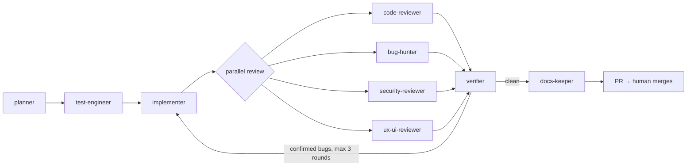

# dev_template

A universal GitHub template for building apps and software with a team of AI agents
that plan, test, implement, review and verify each other's work. Works with
**Claude Code** (primary), **OpenAI Codex** and **GitHub Copilot** from one set of
instructions.

The design follows published practice from Anthropic, OpenAI and GitHub; see
[`docs/research.md`](docs/research.md) for the sources.

## Quick start

1. Click **Use this template** → create your new repository, then clone it.
2. Open it in Claude Code and run `/bootstrap-project`. It interviews you about the
   product and stack, fills in all placeholders, scaffolds the app and makes `make check` green.
3. Build features with `/feature <description>`.
4. Optional: enable AI review on PRs (see [CI](#ci)).

## How the agents work together



- Tests are written **before** the code, by a different agent than the implementer.
- Reviewers work in **fresh contexts** and in **parallel**; each finding needs a
  concrete failure scenario.
- The **verifier** re-checks every finding against the code and drops false positives
  before anything gets fixed.
- **Hooks** block dangerous commands and edits to secrets; **CI** re-checks everything.
- **Memory** in `memory/` lets the next session continue where the last one stopped.

Full protocol: [`docs/agent-workflow.md`](docs/agent-workflow.md).

## Skills (slash commands)

| Command | What it does |
| --- | --- |
| `/bootstrap-project` | One-time setup of a new project from this template |
| `/feature <desc>` | Full pipeline: plan → tests → implement → review → verify → fix → docs |
| `/review [PR/branch]` | Multi-agent review with false-positive filtering |
| `/bug-hunt <area>` | Adversarial bug hunt with reproductions and regression tests |
| `/ux-audit [url]` | Real-browser UX/UI and WCAG 2.2 AA audit with screenshots |
| `/adr <title>` | Architecture Decision Record |
| `/handoff` | End-of-session memory update |

## Repository layout

```
AGENTS.md                  canonical instructions for all agents (Codex, Copilot, Claude)
CLAUDE.md                  imports AGENTS.md + memory, Claude-specific notes
REVIEW.md                  what reviewers flag, severity scale
Makefile                   setup / lint / test / e2e / check / dev - the one verification entry point
.mcp.json                  Playwright MCP for browser-based UX review and e2e
.claude/
  agents/                  9 subagents (source of truth)
  skills/                  7 skills (source of truth)
  hooks/                   guard-bash, protect-files, post-edit-format
  rules/                   path-scoped rules (testing, frontend)
  settings.json            hooks + permissions
.codex/agents/             generated Codex subagents
.agents/skills/            generated Codex skills
.github/
  agents/                  generated Copilot custom agents
  copilot-instructions.md  points to AGENTS.md
  workflows/               ci.yml, claude.yml (@claude), claude-review.yml (PR review)
  ISSUE_TEMPLATE/, pull_request_template.md
docs/
  agent-workflow.md        roles, pipeline, handoff and finding formats
  research.md              sources behind the design
  architecture.md, adr/, specs/
memory/
  project-context.md       goals, users, constraints (always loaded)
  lessons-learned.md       rules learned from mistakes (always loaded)
  decisions.md             decision log
  progress.md              session handoff log
  features.json            feature list with pass/fail status
scripts/sync_agents.py     generates Codex/Copilot copies from .claude/
.work/                     git-ignored scratch space for agent handoffs
```

## Editing agents and skills

Edit only `.claude/agents/*.md` and `.claude/skills/*/SKILL.md`, then run:

```bash
python3 scripts/sync_agents.py
```

CI fails if the generated copies in `.github/agents/`, `.codex/agents/` and
`.agents/skills/` are stale.

## CI

- **`ci.yml`** - always on: validates agent config, shellchecks and tests the hooks,
  runs `make check`.
- **`claude.yml`** - mention `@claude` in an issue or PR comment. Needs the
  [Claude GitHub App](https://github.com/apps/claude) and an `ANTHROPIC_API_KEY` (or
  `CLAUDE_CODE_OAUTH_TOKEN`) secret.
- **`claude-review.yml`** - independent AI review on every PR. Off by default; enable by
  setting the repository variable `ENABLE_CLAUDE_REVIEW=true` and the secret above.

## Cost note

Multi-agent pipelines use many more tokens than a single chat (Anthropic measured about
15x for their research system). Use `/feature` for real features; for one-line fixes,
just ask for the fix and run `/review` once.

## License

Choose a license for your project (https://choosealicense.com/) and add a `LICENSE` file.
