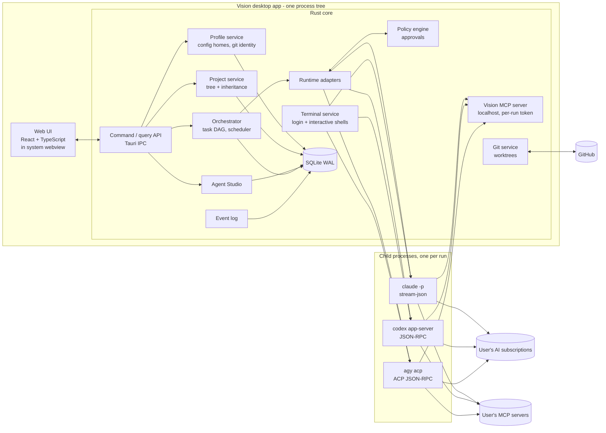
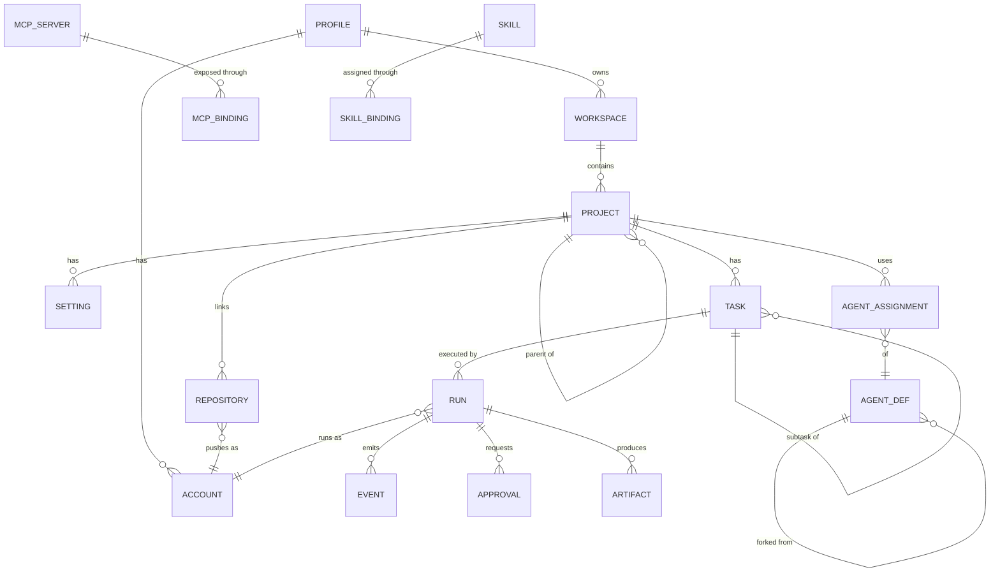

# Vision: implementation plan

- **Status:** Proposed, revision 2, for review by the product owner (Jakub)
- **Date:** 2026-11-13
- **Input:** product specification "Vision v0.2", plus these product decisions from Jakub:
  1. **No API keys.** Users sign in to their own AI subscriptions through the official
     CLIs (Claude Code, Codex, possibly Antigravity), exactly as they do in a terminal.
  2. **Account profiles** (for example *Work* and *Personal*). Each profile has its own
     GitHub account and its own AI and tool logins, kept separate.
  3. **Runs on macOS, Windows and Linux.**
  4. **Open source, downloadable desktop software. Nothing is hosted.** The user installs
     Vision, signs in to their subscriptions and uses it locally.
  5. Language is not a goal in itself; **speed matters**.
- **Scope of this document:** architecture, technology choice with evidence, data model,
  profile and credential model, roadmap with concrete milestones, risks and open
  questions. No implementation code.

Evidence convention (same as [`research.md`](research.md)): factual claims link to a
source. Claims without one are tagged `[no source: estimate]`,
`[no source: common convention]` or `[no source: to verify]`. Design choices are
labelled *[opinion]*. Statements about provider terms are my reading of the linked
pages, not legal advice.

### Changes from revision 1

| Area | Revision 1 | Revision 2 |
| --- | --- | --- |
| AI access | API keys stored in a Vision vault | User signs in through each official CLI; **Vision never sees or stores AI credentials** |
| Runtimes | Claude Agent SDK library, Codex, ACP, direct model calls | Drive the **unmodified CLIs** over their own stdio protocols: `claude -p` stream-json, `codex app-server`, `agy acp` |
| Core language | TypeScript / Node.js sidecar | **Rust inside the Tauri app** (no sidecar), TypeScript only for the UI |
| Deployment | Desktop and Docker / NAS server | **Desktop only** (macOS, Windows, Linux); server mode is out of scope |
| Profiles | Profile owns encrypted secrets | Profile owns **isolated config directories** for each CLI, plus git identity |

---

## 1. Summary of the recommendation

1. **A single desktop app.** Tauri 2 with a Rust core and a web UI (React + TypeScript).
   One binary per OS, no bundled browser engine and no separate Node.js process. *[opinion,
   reasoning in §3]*
2. **Vision is an orchestrator around the official agent CLIs, not a new agent.** Each
   agent run is a child process of the user's own installed `claude`, `codex` or `agy`
   binary, started with the profile's config directory and a git worktree as its working
   directory. Vision talks to it over the CLI's documented machine interface.
3. **Sign-in happens inside each CLI's own flow.** Vision opens a built-in terminal that
   runs, for example, `claude auth login` with the profile's config directory. Anthropic
   explicitly allows an end user "signing in to the unmodified Claude Code binary with
   their own Claude subscription", while forbidding third-party apps from offering
   claude.ai login or storing claude.ai tokens
   ([Claude Code legal and compliance](https://code.claude.com/docs/en/legal-and-compliance)).
   Codex app-server auth may keep being used by "local or open-source apps"
   ([Codex app-server](https://learn.chatgpt.com/docs/app-server.md)).
4. **A profile is a set of separate config homes.** Work and Personal each get their own
   `CLAUDE_CONFIG_DIR`, `CODEX_HOME`, `GH_CONFIG_DIR` and git identity. Claude Code
   documents exactly this pattern for work and personal accounts
   ([Claude Code authentication](https://code.claude.com/docs/en/authentication)).
5. **One policy engine for every runtime.** All three CLIs can hand a permission decision
   to the host process, so Vision applies one set of rules and shows one approval card
   for all of them (§5.3).
6. **Agents collaborate through a Vision MCP server** (`create_subtask`,
   `request_review`, `report_blocker`, ...) instead of sharing context (§5.4).
7. **A project knowledge layer** ("second brain"): agents propose decisions, conventions
   and lessons, the user approves them, and they are stored as plain Markdown that child
   projects inherit; a local full-text index makes them searchable for agents. Plus an
   idea inbox, a usage overview across profiles, and workflow templates (§7).
8. **Roadmap:** Phase 0 for the app skeleton and profiles, then a single-agent vertical
   slice with Claude Code early, because the CLI integration is the riskiest part.
   Milestones M0 to M8 lead to the spec's acceptance scenario, and M9 adds the project knowledge layer (§7, §9).

---

## 2. Architecture



### 2.1 Components

| Component | Responsibility |
| --- | --- |
| **UI** | All screens from spec §11. Talks to the core through Tauri commands and an event channel. |
| **Profile service** | Profiles, their config directories, git identity, sign-in status per tool (§6). |
| **Project service** | Workspaces, nested projects, move/reorder/archive, settings with inheritance and provenance (§4.3). |
| **Agent Studio** | Built-in templates (read-only), forks, versions, import/export (§5.1). |
| **Orchestrator** | Tasks, task DAG, scheduling, concurrency limits, retries, pause/resume/cancel (§5.5). |
| **Policy engine** | Allow / deny / ask-human for tool calls, commands, pushes (§5.3). |
| **Runtime adapters** | Start a CLI, translate its stream into Vision events, relay permission requests (§5.2). |
| **Vision MCP server** | Collaboration tools offered to every run (§5.4). |
| **Git service** | Clones, worktrees, branches, diffs, PRs through `gh` (§5.6). |
| **Terminal service** | Pseudo-terminals for CLI sign-in and for "open a shell in this worktree". |
| **Event log** | Append-only `event` table: history, live view, metrics (§4.4). |

### 2.2 Process model

- Agent work never runs inside the app process. Each run is a child process, so a hung or
  crashed CLI cannot freeze the UI or other runs. *[opinion]*
- The core runs on an async runtime with a bounded number of concurrent runs per profile
  and per tool (configurable).
- Perceived speed is dominated by the model and the CLI, not by Vision `[no source:
  estimate]`. Vision's own speed budget is about startup, navigation and rendering streams;
  targets are listed per milestone in §9.

---

## 3. Technology selection

Criteria, in order: (1) the integration surface we actually need (subprocess protocols,
PTY, git, OS keychain), (2) speed and memory of a desktop app running many child
processes, (3) cross-platform packaging for macOS, Windows and Linux, (4) maintainability,
(5) contributor friendliness for an open-source project.

### 3.1 What changed the language decision

Revision 1 picked TypeScript mainly because the Claude Agent SDK library exists only for
TypeScript and Python. With subscription sign-in, Vision should **not** embed the Agent
SDK: Anthropic's terms tell developers building on the Agent SDK to use API key
authentication and forbid routing requests through Free, Pro or Max credentials on behalf
of users ([legal and compliance](https://code.claude.com/docs/en/legal-and-compliance)).
Driving the user's own `claude` binary is the permitted path. Every runtime is then a
**language-neutral subprocess protocol**, so the SDK argument disappears.

### 3.2 Core language and desktop shell

| Option | Evidence | Assessment |
| --- | --- | --- |
| **Tauri 2 + Rust core** (recommended) | Uses the system webview, so a minimal app "can be less than 600KB" ([Tauri](https://v2.tauri.app/start/)); Rust core is native to Tauri. MCP Rust SDK is Tier 1 ([MCP SDKs](https://modelcontextprotocol.io/docs/sdk)). OS credential stores on all three platforms through the `keyring` crate ([keyring](https://docs.rs/crate/keyring/3.6.3/source/README.md)). | Smallest download and memory footprint; one process tree, no sidecar packaging. Slower to write than TypeScript, but the core is mostly protocol glue and state, and the UI stays TypeScript. |
| Tauri 2 + Node.js sidecar | Sidecar must be packaged as a binary per target, for example with `pkg` ([Tauri: Node.js as a sidecar](https://v2.tauri.app/learn/sidecar-nodejs/)) | Faster to write; two runtimes to ship, update and debug. Fallback if Rust slows the project down. |
| Electron + TypeScript | Main process runs Node.js, one renderer process per window, inherited from Chromium ([Electron process model](https://electronjs.org/docs/latest/tutorial/process-model)) | Most mature tooling; ships its own browser engine with every app, so larger download and memory `[no source: common convention]`. |

**Decision: Tauri 2 + Rust core + React/TypeScript UI** (accepted by Jakub on
2026-11-13, to be recorded as an ADR in M0). It best matches
"speed matters" and "downloadable software", and nothing in the integration surface needs
Node.js any more. Risks: webview differences between OSes (WebKitGTK on Linux, WebView2
on Windows, WKWebView on macOS) `[no source: common convention]` and Rust's learning
curve. Both are tested in the M0 spike (§9) before the decision becomes an ADR. *[opinion]*

### 3.3 Frontend

React + TypeScript + Vite, a virtualized tree for the project sidebar, a graph view for
execution DAGs, and TypeScript types generated from the Rust command definitions so UI and
core cannot drift. React is chosen for its component ecosystem, not for speed `[no source:
common convention]`. *[opinion]*

### 3.4 Storage

- **SQLite in WAL mode**, one file in the user's app data directory. Readers do not block
  the writer and vice versa, there is one writer at a time, and WAL does not work on a
  network filesystem ([SQLite WAL](https://www.sqlite.org/wal.html)). The core is the only
  writer and the file lives on local disk, so both limits are fine.
- **Hierarchy:** adjacency list (`parent_id`) plus a materialized path for fast subtree
  reads; recursive CTEs for ancestor walks
  ([SQLite WITH clause](https://www.sqlite.org/lang_with.html)).
- **User-owned files:** agent definitions, skills and project instructions are also
  written as plain Markdown files, so users can version them in git and leave Vision
  without losing anything (spec §14).

### 3.5 Runtimes

| Runtime | Interface Vision uses | Sign-in | Per-profile isolation | Permission hand-off |
| --- | --- | --- | --- | --- |
| **Claude Code** | `claude -p --output-format stream-json` (newline-delimited events, session resume, MCP config by flag) ([headless](https://code.claude.com/docs/en/headless.md)) | `claude auth login`, Anthropic's own browser flow ([authentication](https://code.claude.com/docs/en/authentication)) | `CLAUDE_CONFIG_DIR`: "each directory has its own settings, session history, and claude.ai login", and the macOS Keychain entry is keyed to that directory ([authentication](https://code.claude.com/docs/en/authentication)) | `--permission-prompt-tool` (an MCP tool) or a `PermissionRequest` hook ([headless](https://code.claude.com/docs/en/headless.md)) |
| **Codex** | `codex app-server`: JSON-RPC over stdio, threads, turns, items ([app-server](https://learn.chatgpt.com/docs/app-server.md)) | ChatGPT sign-in in browser or device code (`codex login --device-auth`) ([Codex auth](https://learn.chatgpt.com/docs/auth.md)) | `CODEX_HOME`; credentials in `auth.json` under it with `cli_auth_credentials_store = "file"`, or in the OS keychain ([Codex auth](https://learn.chatgpt.com/docs/auth.md)) | Server sends approval requests: `accept`, `acceptForSession`, `decline`, `cancel` ([app-server](https://learn.chatgpt.com/docs/app-server.md)) |
| **Antigravity** (optional) | `agy acp`: ACP over JSON-RPC on stdio ([Antigravity ACP](https://antigravity.google/docs/cli/acp.md)); also `agy -p --output-format stream-json` ([headless](https://antigravity.google/docs/cli/headless.md)) | Interactive `agy` or `agy acp --login`; Google account, Gemini Enterprise or API key options ([ACP guide](https://antigravity.google/docs/ide/extensions/acp/)) | **Not documented.** Settings live under `~/.gemini/antigravity-cli/`, with no documented variable to relocate them `[no source: to verify]` | ACP `session/request_permission` ([ACP overview](https://agentclientprotocol.com/protocol/v2/overview)) |

Notes:

- **Do not use `--bare` for Claude Code runs.** Bare mode "never reads OAuth credentials or
  the system keychain", so it cannot use a subscription
  ([headless](https://code.claude.com/docs/en/headless.md)). Non-bare `-p` loads hooks and
  MCP servers from the repository without a trust prompt (same page), so Vision must treat
  repository content as untrusted and show it to the user on first run in a project.
- **The ACP adapter is generic.** Over 60 agents speak ACP ([zed.dev/acp](https://zed.dev/acp)),
  so the same adapter can later add Gemini CLI, OpenCode and others.
- **Do not bundle the CLIs.** The user installs them; Vision detects their versions. That
  keeps the binaries "installed and run as published" and avoids redistributing them
  ([legal and compliance](https://code.claude.com/docs/en/legal-and-compliance)). *[opinion
  on the bundling question]*

### 3.6 MCP

- Users' own MCP servers are attached **by the CLI that runs the agent**. Vision writes a
  per-run MCP config (for Claude Code, `--mcp-config`) containing only the servers the
  agent is allowed to use (spec §6: no automatic access to every server). OAuth tokens for
  remote MCP servers therefore stay inside each CLI's profile config directory, not in
  Vision.
- Vision itself runs one MCP server (§5.4) and an MCP client only for health checks and
  tool discovery, built on the official Rust SDK.
- The protocol is changing: revision **2026-07-28** makes the core stateless, removes the
  `initialize` handshake and hardens authorization, including `application_type` in client
  registration, which affects desktop and CLI clients
  ([MCP blog](https://blog.modelcontextprotocol.io/posts/sdk-betas-2026-07-28/)). Vision
  wraps the SDK behind its own interface and pins exact versions.

### 3.7 Prior art

Many parallel-agent tools already run one git worktree per agent: Emdash, Claude Squad,
Vibe Kanban, Agent Orchestrator, Conductor and others
([Augment Code overview, 2026](https://www.augmentcode.com/tools/open-source-agent-orchestrators)).
None of those listed there is described as combining nested projects with inheritance,
an agent studio and per-profile account isolation; that combination is Vision's niche.
*[opinion, based on that overview only]*

---

## 4. Domain and data model

### 4.1 Hierarchy

```
Vision app (one per OS user)
└── Profile                    (Work, Personal, ...)  ← isolation boundary
    ├── Accounts               (Claude Code, Codex, Antigravity, GitHub: one config home each)
    ├── Git identity           (name, email, signing key, SSH key reference)
    └── Workspace              (one or more)
        ├── Project tree       (unbounded depth)
        ├── Agent library      (profile scope)
        ├── MCP server configs (profile scope)
        └── Skills             (profile scope)
Shared library (app scope, no account data): built-in agents, templates, shared skills
```

### 4.2 Entities



| Entity | Key fields | Notes |
| --- | --- | --- |
| `profile` | id, name, color, icon, git_author_name, git_author_email, ssh_key_path, default_budget | Badge and color visible on every screen |
| `account` | id, profile_id, tool (`claude_code`, `codex`, `antigravity`, `github`), config_home, login_label, last_checked_status | **No tokens.** `config_home` is a directory Vision creates and passes to the CLI. A profile may hold two GitHub accounts. |
| `workspace` | id, profile_id, name, settings | |
| `project` | id, workspace_id, parent_id, path, sort_key, name, archived_at | `path` = materialized path |
| `setting` | project_id, category, mode (`inherit`, `override`, `disable`), payload, removed_keys | §4.3 |
| `repository` | id, project_id, account_id (GitHub), remote_url, default_branch, local_path | Account must belong to the project's profile |
| `agent_def` | id, scope (`builtin`, `shared`, `profile`, `project`), owner_id, based_on_id, version, spec (JSON), archived_at | Built-ins immutable; editing forks |
| `agent_assignment` | project_id, agent_def_id, overrides, inherited_from | |
| `mcp_server` | id, scope, transport, command or url, env template | Config only |
| `mcp_binding` | target (project or agent), mcp_server_id, tool_allowlist | Default is no access |
| `skill`, `skill_binding` | `SKILL.md` content, scope, assignment | |
| `task` | id, project_id, parent_task_id, title, spec, status, depends_on[] | DAG |
| `run` | id, task_id, agent_def_id + version, tool, account_id, worktree_path, branch, status, session_ref, usage, started_at, ended_at | Account fixed for the run's lifetime |
| `event` | run_id, seq, ts, type, payload | Append-only |
| `approval` | run_id, action, target, risk, status, decided_at | |
| `artifact` | run_id, kind (diff, file, report, PR), ref | |
| `audit_log` | ts, profile_id, actor, action, target, result | Never pruned |

### 4.3 Inheritance resolver

One `setting` row per category: instructions, coding standards, MCP bindings, agent
assignments, skills, knowledge docs, permissions.

| Mode | Meaning |
| --- | --- |
| `inherit` | Parent's effective value, plus local additions, minus `removed_keys` |
| `override` | Only the local value |
| `disable` | Empty here and for inheriting children |

Merge rules: lists are **union minus explicit removals**; scalars are **nearest wins**;
text is **concatenated root to leaf** with a heading naming the source project. Every
resolved value carries its **provenance** (`local` or `inherited from DataBrain`), shown as
a badge (spec §3.1). Effective settings are cached per project and invalidated by
subtree. Inheritance never crosses a profile. *[opinion]*

### 4.4 Event log

Each adapter maps its CLI's stream into typed Vision events (`message`, `tool_call`,
`tool_result`, `file_change`, `command`, `approval_requested`, `usage`, `status`). The UI
subscribes to a filtered stream, batched (for example every 50 ms) so a chatty agent
cannot flood rendering `[no source: estimate]`. The raw CLI stream is kept per run for
debugging adapter bugs.

---

## 5. Agents, runtimes and orchestration

### 5.1 Agent definition

A versioned document, exported as Markdown with YAML frontmatter (aligned with Claude Code
subagent files where fields overlap, see [`research.md`](research.md) §1). Fields follow
spec §4.3:

- identity: name, slug, description, icon, role, specialization
- instructions: system prompt, rules, responsibilities, constraints, output format
- runtime: **tool** (`claude_code`, `codex`, `antigravity`, or "any"), model, reasoning
  effort, limits (turns, wall time)
- tools: MCP server refs with tool allowlists, skill refs
- permissions: filesystem, git (read, commit, push, PR), shell (deny / allowlist / ask),
  deploy, approval rules
- collaboration: may delegate, may contact, may request review, may create subtasks

The agent names a **tool**, never an account. At run time Vision picks that tool's account
from the run's profile. The same "Senior Developer" therefore runs on your work Claude
login in a Work project and on your personal login in a Personal project. Missing account
= the run fails fast ("Work profile is not signed in to Codex").

Built-in templates (the 12 from spec §4.1) ship as files and are read-only; editing one
creates a fork with `based_on_id` and a diff view.

### 5.2 Runtime adapter interface

```
start(runSpec) -> RunHandle         // spawn CLI: env = profile config homes, cwd = worktree
events(RunHandle) -> stream<Event>  // normalized Vision events
respond(RunHandle, approvalDecision)
steer(RunHandle, message)           // where supported (Codex turn/steer)
cancel(RunHandle), resume(session)  // where supported
```

Capability flags per adapter tell the UI which controls to show (spec §10: pause, resume
and cancel *supported* executions). An adapter conformance test suite runs against each
CLI version Vision supports.

### 5.3 One policy engine for every runtime

| Runtime | Hook |
| --- | --- |
| Claude Code | `--permission-prompt-tool` pointing at a tool on the Vision MCP server, or a `PermissionRequest` hook ([headless](https://code.claude.com/docs/en/headless.md)) |
| Codex | Approval requests from app-server ([app-server](https://learn.chatgpt.com/docs/app-server.md)) |
| ACP agents | `session/request_permission` ([ACP](https://agentclientprotocol.com/protocol/v2/overview)) |

The adapter forwards each request to the policy engine, which evaluates agent, project and
profile rules and returns allow, deny or "ask the human" (an approval card in the UI).
Destructive actions (force push, branch deletion, deploy, recursive deletes) always need a
human (spec §13). Each decision goes to `audit_log`.

### 5.4 Collaboration through the Vision MCP server

The core runs an MCP server on localhost. Each run gets its own token, so a run can only
see and act on its own task tree.

| Tool | Purpose |
| --- | --- |
| `vision.create_subtask(title, spec, agent?, depends_on?)` | Delegation |
| `vision.request_review(artifact, reviewer?)` | Review workflow |
| `vision.report_blocker(reason)`, `vision.ask_human(question)` | Escalation |
| `vision.publish_artifact(kind, ref, summary)` | Results and findings |
| `vision.get_task(id)`, `vision.get_artifact(id)` | Structured context by reference |
| `vision.permission_prompt(...)` | Claude Code permission hand-off (§5.3) |

Agents stay decoupled (spec §5) and every hand-off becomes an auditable event. *[opinion]*

### 5.5 Orchestration modes

- **Autonomous:** the Engineering Manager agent builds the task DAG with
  `vision.create_subtask`; the scheduler runs ready tasks in parallel within limits.
- **Workflow:** a stored DAG template authored by the user; same scheduler.
- **Limits instead of money budgets.** With subscriptions there is no per-run bill, but
  there are usage limits. Anthropic says advertised Pro and Max limits "assume ordinary,
  individual usage" ([legal and compliance](https://code.claude.com/docs/en/legal-and-compliance)),
  and multi-agent systems use many more tokens than chats (about 15x in Anthropic's
  research system,
  [Anthropic Engineering](https://www.anthropic.com/engineering/multi-agent-research-system)).
  Vision therefore caps parallel runs per account (default 2 to 3 `[no source: estimate]`),
  shows usage reported by each CLI, and pauses a task tree when a CLI reports a rate limit
  (Claude Code emits `api_retry` events with error `rate_limit`,
  [headless](https://code.claude.com/docs/en/headless.md)).

### 5.6 Git isolation

- One **git worktree per write-capable run** on branch `vision/<task-id>/<agent-slug>`.
  Git refuses to check out one branch in two worktrees
  ([git-worktree](https://www.kernel.org/pub/software/scm/git/docs/git-worktree.html)).
- Read-only agents share a read-only checkout.
- Integration is a merge step or a PR, never a direct write to the default branch.
- Docker execution (spec Phase 5) reuses the adapter interface with the worktree mounted.

---

## 6. Profiles and account isolation

### 6.1 Where profiles sit

| Option | Verdict |
| --- | --- |
| **A. Profile above workspaces** (recommended) | Switching profile switches the whole visible context, like browser profiles. One place to enforce isolation. |
| B. Profile chosen per project inside a shared workspace | Mixes work and personal accounts in one tree; easy to push work code as the personal account. |
| C. Profile = workspace | Simpler, but loses several workspaces per profile. |

**Recommendation: A**, plus an app-level *Shared library* for agent templates and skills,
which contain no account data. *[opinion]*

**Sharing is the user's choice (decided 2026-11-13).** An app setting controls it:
*shared library on* (default) lets every profile use shared agents and skills; *off* keeps
each profile fully separate. Per item, the user can also publish a profile's agent or
skill to the shared library or keep it private to that profile. Publishing strips
profile-specific bindings such as MCP servers and repository links.

### 6.2 What a profile contains

```
<app data>/profiles/<profile-id>/
├── claude/       → CLAUDE_CONFIG_DIR
├── codex/        → CODEX_HOME (config.toml sets cli_auth_credentials_store = "file")
├── gh/           → GH_CONFIG_DIR
├── antigravity/  → see §6.4
└── profile.json  → git identity, SSH key path, limits, color
```

| Tool | How the profile's account is used | Source |
| --- | --- | --- |
| Claude Code | Every run starts with `CLAUDE_CONFIG_DIR=<profile>/claude`. Login, settings and history are per directory; on macOS the Keychain entry is keyed to the directory. | [Claude Code authentication](https://code.claude.com/docs/en/authentication) |
| Codex | `CODEX_HOME=<profile>/codex`. With file storage, credentials live in `auth.json` under `CODEX_HOME`. Whether the `keyring` mode separates entries by `CODEX_HOME` is not documented, so Vision forces `file` `[no source: to verify]`. | [Codex auth](https://learn.chatgpt.com/docs/auth.md) |
| GitHub | `GH_CONFIG_DIR=<profile>/gh` for `gh`; sign-in with `gh auth login`. Each worktree sets `credential.https://github.com.helper` to `gh auth git-credential` (what `gh auth setup-git` configures), so git asks `gh` from the run's profile. Git supports per-URL helpers. | [gh environment](https://cli.github.com/manual/gh_help_environment), [gh auth setup-git](https://cli.github.com/manual/gh_auth_setup-git), [gitcredentials](https://git-scm.com/docs/gitcredentials/2.50.0) |
| Commit identity | Per-worktree `user.name`, `user.email`, signing key from the profile | [no source: common convention] |
| SSH remotes | Per-worktree `core.sshCommand` with the profile's key | `[no source: to verify exact flags]` |

### 6.3 Sign-in flow

1. Settings → Profile *Work* → Accounts → "Sign in to Claude Code".
2. Vision opens its built-in terminal running `claude auth login` with
   `CLAUDE_CONFIG_DIR=<work>/claude`. The browser opens Anthropic's own page; Vision never
   handles the token. This matches the rule that "sign-in to a Claude account must
   complete through Anthropic's own flow"
   ([legal and compliance](https://code.claude.com/docs/en/legal-and-compliance)).
3. Vision checks the result by running the CLI's status command and stores only a label
   (for example the account email shown by the CLI) and the time of the check.
4. Same pattern for `codex login` (or `--device-auth`), `gh auth login` and `agy`.

Vision does **not** use `claude setup-token`: that would mean Vision storing a
long-lived subscription token, which the terms rule out for third-party developers
([legal and compliance](https://code.claude.com/docs/en/legal-and-compliance)).

### 6.4 Antigravity

The docs show no supported way to keep two Antigravity logins apart
([ACP guide](https://antigravity.google/docs/ide/extensions/acp/),
[headless](https://antigravity.google/docs/cli/headless.md)). Options, in order of
preference: (a) wait for or request a documented config-dir variable, (b) allow
Antigravity in **one profile only** until then, (c) override `HOME` / `USERPROFILE` for the
`agy` process, which may break other things `[no source: to verify]`. Recommendation:
(b) for the MVP. Whether Google permits an external app to orchestrate `agy` with a
personal account is unanswered officially (a community thread asks and has no Google
reply, [Google AI forum](https://discuss.ai.google.dev/t/is-external-orchestration-of-antigravity-cli-headless-mode-supported-with-account-based-usage/183051)),
so Antigravity stays optional and behind a feature flag.

### 6.5 What Vision still stores, and how

Vision stores no AI or GitHub tokens. It still needs a small vault for **user-entered
secrets for MCP servers** (for example a database password in an MCP server's env). Those
go into the OS credential store (macOS Keychain, Windows Credential Manager, Linux Secret
Service) through the `keyring` crate
([keyring](https://docs.rs/crate/keyring/3.6.3/source/README.md)), namespaced by profile,
and are injected only into the environment of the run that needs them.

### 6.6 Isolation rules and residual risk

- A run's environment contains only its own profile's config homes; Vision clears
  inherited variables like `GH_TOKEN`, `ANTHROPIC_API_KEY` and `CLAUDE_CODE_OAUTH_TOKEN`
  that would otherwise override the profile login (Claude Code ranks such variables above
  `/login` credentials, [authentication](https://code.claude.com/docs/en/authentication)).
- Inheritance, agent assignment and repository links never cross profiles. Moving a
  project to another profile opens a "rebind accounts" dialog.
- Pushing, opening a PR or starting a run always shows which account will be used.
- **Residual risk:** an agent with shell access runs as the same OS user and could, in
  principle, read another profile's config directory. Profiles protect against mistakes
  (wrong account), not against a malicious agent. Mitigations: deny shell reads outside the
  worktree in the policy engine, and later run agents in containers (Phase 5). *[opinion]*

### 6.7 UX

- Profile switcher top-left, keyboard shortcut, profile color as a thin window frame and on
  every run card. *[opinion]*
- Runs keep their profile after a switch; the dashboard can show all profiles or one.
- Account status panel per profile: signed in / expired / CLI missing, with "Sign in" and
  "Install" buttons that link to the official install pages.

---

## 7. Knowledge layer ("second brain" for projects)

The aim is not general note-taking but a **knowledge layer per project** that agents read
and write, that the user approves, and that follows the project tree's inheritance
(§4.3). Everything stays local and in plain files. *[opinion: scope and design]*

### 7.1 Project memory

| Kind | Example | File |
| --- | --- | --- |
| Decision (ADR) | "Use dbt incremental models for Sklik" | `decisions/NNNN-<slug>.md` |
| Convention | "SQL keywords upper case, CTEs over subqueries" | `conventions.md` |
| Lesson learned | "Meta Ads API paginates by cursor, never by offset" | `lessons.md` |
| Glossary | "ROAS = revenue / ad spend" | `glossary.md` |
| Why-notes | "We split Semantic Layer out because ..." | `notes/<slug>.md` |

- **Agents propose, the user approves.** A run calls
  `vision.propose_memory(kind, text, evidence_refs)`. The proposal lands in a **memory
  inbox** with the evidence (run, diff, test output). Approve, edit or reject; approved
  entries are written to the files above. Nothing becomes "memory" silently, which keeps
  wrong lessons from spreading to every later run. *[opinion]*
- **Where the files live** is a per-project choice: inside the repository (for example
  `docs/` and `memory/`, versioned with the code and readable by agents outside Vision)
  or in Vision's local project folder (for projects without a repo, or private notes).
- **Format:** Markdown with YAML frontmatter (kind, status, date, source run) and
  `[[wiki-links]]` between notes, so the folder also opens as an Obsidian vault
  `[no source: to verify Obsidian link and frontmatter compatibility]`.
- **Inheritance:** a child project sees its ancestors' memory with provenance badges, like
  every other setting. A parent's convention can be overridden locally.
- **Hand-off into runs:** the resolver builds a short, ranked memory digest for each run
  (conventions and decisions of the project path), injected into the agent's instructions;
  the rest is reachable through search (§7.2). Keeping injected context short follows the
  same reasoning as the repo's own guidance that long always-loaded instruction files
  reduce adherence ([`research.md`](research.md) §1, Memory).

### 7.2 Local search over project context

- **Index:** SQLite FTS5 with BM25 ranking ([SQLite FTS5](https://www.sqlite.org/fts5.html))
  over project memory, knowledge docs, task specs, artifacts and run summaries. Code is
  not copied into the index; agents already search code with their CLI's own tools inside
  the worktree. *[opinion]*
- **Semantic search** with a local embedding model is a later option behind a setting,
  once FTS5 is shown to be insufficient `[no source: to verify model size and speed on
  laptops]`.
- **Access for agents:** `vision.search(query, scope)` and `vision.get_doc(id)` on the
  Vision MCP server, scoped to the run's project path and profile.
- **Privacy, stated plainly:** the index never leaves the machine, but whatever an agent
  reads from search results is sent to that agent's model provider as part of its
  context, like any file it reads.

### 7.3 Idea inbox

- Global quick capture (keyboard shortcut, tray menu) saves a thought with an optional
  project.
- Triage view: assign project, then turn into a task with one click, optionally with a
  workflow template (§7.5) and an agent.
- Ideas are plain records in the profile's database and exportable as Markdown.

### 7.4 Subscription usage overview

- One panel across all profiles: per account, runs in progress, recent usage, rate-limit
  hits and the time until the CLI says it will retry.
- **Only what the CLIs report.** Claude Code's stream includes per-run usage, a
  client-side cost estimate (`total_cost_usd`) and `api_retry` events with error
  `rate_limit` ([headless](https://code.claude.com/docs/en/headless.md)). Whether Codex and
  Antigravity expose remaining quota to a client is `[no source: to verify per CLI]`.
  Vision never scrapes provider websites for quota.
- Feeds the scheduler: an account that is rate-limited gets no new runs until it recovers
  (§5.5).

### 7.5 Workflow templates

Stored, shareable DAG templates (shared library, §6.1), shipped with sensible defaults:

| Template | Steps |
| --- | --- |
| Fix issue | Read issue → implement in worktree → reviewer → QA → PR |
| Feature (test-first) | Architect plan → tests first → implement → parallel review → verify findings → PR, mirroring this repository's own `/feature` pipeline ([`agent-workflow.md`](agent-workflow.md)) |
| Bug hunt | Debugger reproduces → fix → regression test → review |
| Docs refresh | Documentation agent updates docs from recent merges → review |

Each template declares its agents by role, so it works with the user's forks of the
built-in agents.

---

## 8. Distribution (no hosting)

- **Desktop app only**, built for macOS (Apple Silicon and Intel), Windows and Linux with
  Tauri's bundlers, published as GitHub Releases. *[opinion]*
- **Open source.** License to be chosen (Q1 in §11). Product name and logo must not use
  "Claude Code" or "Anthropic"; plain-text statements such as "runs Claude Code" are
  allowed ([legal and compliance](https://code.claude.com/docs/en/legal-and-compliance)).
- **Prerequisites the user installs:** git, and any of `claude`, `codex`, `gh`, `agy`.
  The first-run wizard detects them and links to the official installers.
- **Code signing:** macOS notarization and Windows signing avoid OS warnings but need paid
  certificates `[no source: common convention]`. Unsigned builds are acceptable for early
  releases.
- **Auto-update** through Tauri's updater with signed release artifacts `[no source: to
  verify plugin details in the M0 spike]`.
- **Data** stays local: one SQLite file plus profile directories; export/import of a
  profile's projects and agents as files.

---

## 9. Roadmap

The spec's five phases stay; Phase 0 is added, and the single-agent vertical slice moves
early. Each milestone ends with `make check` green and a short demo recording
([`AGENTS.md`](../AGENTS.md)).

| Milestone | Spec phase | Scope | Exit criteria |
| --- | --- | --- | --- |
| **M0 Skeleton + spike** | 0 | `bootstrap-project`; Tauri 2 app with Rust core and React UI; SQLite + migrations; `make` targets; CI building on macOS, Windows, Linux; spike: spawn `claude -p` stream-json from Rust and render it live; ADRs for shell, core language, storage, runtime strategy | CI produces installers for all three OSes; spike streams a real Claude Code run into the UI on Jakub's machine |
| **M1 Profiles & accounts** | 0 | Profile CRUD, switcher, colors; per-profile config homes; built-in terminal (PTY) for sign-in; account status checks for Claude Code, Codex, `gh`; git identity | Two profiles signed in to two different Claude and GitHub accounts on one machine; status shows both correctly; test asserts a run's environment contains only its own profile's directories |
| **M2 Projects** | 1 | Workspace, nested projects, rename, archive, move, reorder; virtualized sidebar; settings with inheritance and provenance; basic dashboard; idea inbox (§7.3) | 1 000-node tree; project switch under 100 ms p95 `[no source: estimate, target to validate]`; inheritance tests for all three modes |
| **M3 Git** | 1 | Link repo to a profile's GitHub account; clone; branches, commits, diff view; worktree service with per-worktree credential helper and identity | Push to a private repo as the Work account and to another as the Personal account from the same app |
| **M4 Agent Studio** | 2 | 12 built-in templates; from scratch, duplicate, fork-on-edit; editor; tool and model selection; MCP and skill assignment; permissions; Markdown import/export | Editing a built-in forks it; export and re-import round-trips |
| **M5 First real run** | 3 | Claude Code adapter; worktree per run; event log and live stream; policy engine with approval cards via `--permission-prompt-tool`; cancel and resume; usage display | One agent fixes a seeded bug in a test repo end to end on a subscription login, every tool call visible, one human approval |
| **M6 Codex adapter** | 3 | `codex app-server` adapter with approvals and steering; usage overview across profiles (§7.4) | The M5 scenario passes unchanged on Codex |
| **M7 MCP management** | 2-3 | Add stdio and HTTP servers per profile; per-run MCP config with allowlists; health and tool discovery; keychain-backed env secrets | Agent without a binding cannot see a server; the same server works with different logins in two profiles |
| **M8 Orchestration** | 4 | Vision MCP server; Engineering Manager; task DAG; parallel worktrees; review and QA steps; human approval; concurrency and rate-limit handling; built-in workflow templates (§7.5) | Spec §16 acceptance scenario passes on the DataBrain sample project |
| **M9 Project memory & search** | 5 (new) | Memory files and inbox with approve/edit/reject; `vision.propose_memory`; inherited memory digest per run; FTS5 index; `vision.search` / `vision.get_doc` (§7.1, §7.2) | An agent proposes a lesson, the user approves it, and the next run in a child project receives it and cites it |
| Phase 5 | 5 | Antigravity / generic ACP adapter, workflow editor, container runs, knowledge, analytics | Prioritised after M8 |

After acceptance, one entry per milestone goes into `memory/features.json`, with the exit
criteria as acceptance items.

---

## 10. Risks

| # | Risk | Mitigation |
| --- | --- | --- |
| R1 | **Scope:** the spec is large for a small team | Strict milestone order; vertical slice in M5; Antigravity and workflow editor deferred |
| R2 | **Provider terms change or are read differently.** Today Anthropic allows end users to sign in to the unmodified binary but restricts third-party apps ([legal and compliance](https://code.claude.com/docs/en/legal-and-compliance)); Codex allows local or open-source apps ([app-server](https://learn.chatgpt.com/docs/app-server.md)); Antigravity has no official statement | Never handle tokens; do not modify or bundle CLIs; keep a terms checklist per release; ask the providers before a wide public launch |
| R3 | **Subscription usage limits** with many parallel agents | Per-account concurrency caps, rate-limit pause, cheaper models for routine roles |
| R4 | **CLI output and flag churn** breaks adapters | Supported-version range per CLI, adapter conformance tests, keep raw streams for debugging |
| R5 | **Repository content runs code** (hooks, MCP servers) in non-bare Claude Code runs without a trust prompt ([headless](https://code.claude.com/docs/en/headless.md)) | First-run trust screen per repository listing hooks and MCP servers it would load; policy defaults to deny |
| R6 | **Cross-profile access by a misbehaving agent** (same OS user) | Policy denies paths outside the worktree; containers later; documented limitation |
| R7 | **MCP protocol churn** ([MCP blog](https://blog.modelcontextprotocol.io/posts/sdk-betas-2026-07-28/)) | Wrapper interface, pinned versions, contract tests |
| R8 | **Webview differences** across OSes `[no source: common convention]` | CI and manual smoke tests on all three; Electron stays a fallback because the UI is shell-agnostic |
| R9 | **Rust slows development** | UI and most logic stay simple; if M0 to M2 run far over plan, switch the core to a Node.js sidecar before M5 (the UI and protocol designs do not change) |

---

## 11. Open questions for Jakub

Answered: subscription sign-in via CLI, no API keys; Work/Personal profiles with separate
GitHub and AI logins; Claude Code, Codex, maybe Antigravity; macOS, Windows and Linux;
open source, downloadable, not hosted; language secondary to speed; **Rust core accepted**;
**agents and skills may be shared between profiles, controlled by a user setting** (§6.1).

Still open:

1. **License:** MIT or Apache-2.0 (Apache adds an explicit patent grant), or something else?
2. **Profile placement:** OK with profiles above workspaces (§6.1, option A)?
3. **Antigravity:** acceptable to support it in one profile only until per-profile login is
   documented (§6.4)?
4. **Git hosts:** GitHub only, or also GitLab or self-hosted Gitea?
5. **Work policy:** does your employer allow running these CLIs with work code and a work
   account inside a third-party open-source tool?

---

## 12. Next steps after approval

1. Record the answers as ADRs and in `memory/decisions.md`.
2. Run `bootstrap-project` with the chosen stack.
3. Turn M0 to M8 into `memory/features.json` entries.
4. Start M0 with the Claude Code streaming spike.
