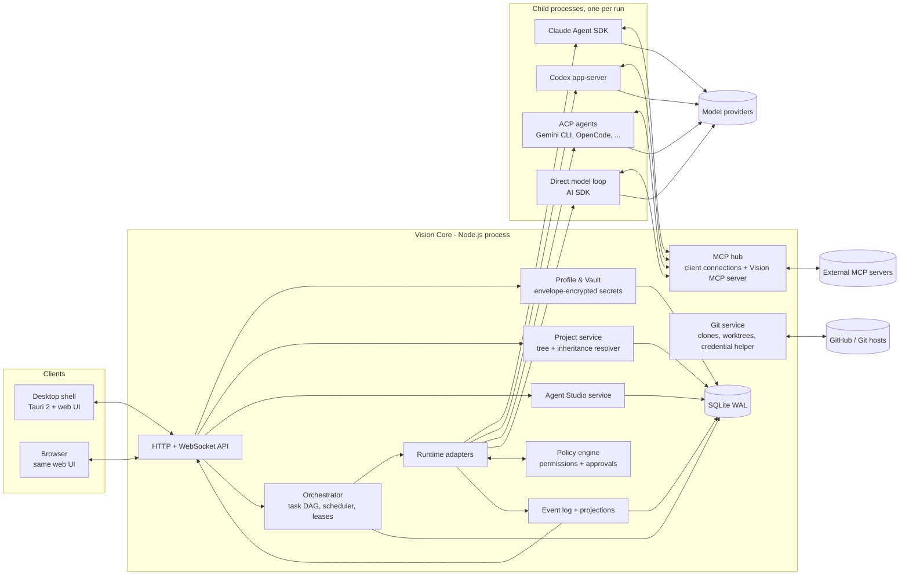
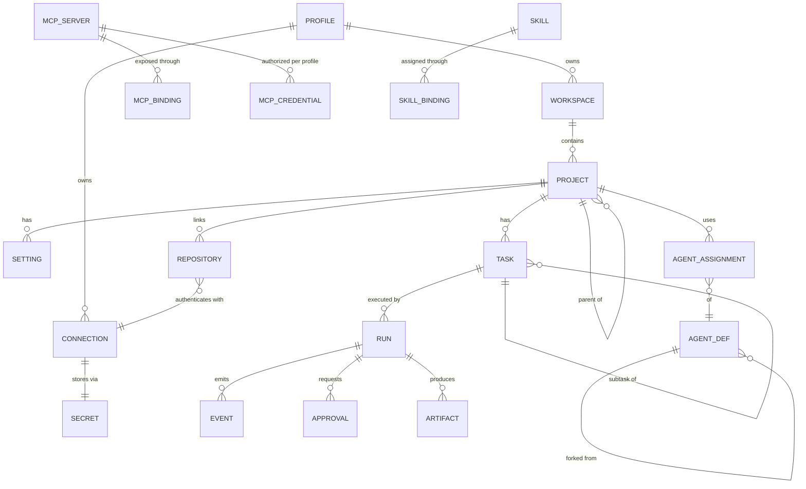

# Vision: implementation plan

- **Status:** Proposed, for review by the product owner (Jakub)
- **Date:** 2026-11-13
- **Input:** product specification "Vision v0.2" plus the requirement to switch between
  account profiles (for example *Work* and *Personal*), each with its own GitHub account
  and other credentials.
- **Scope of this document:** architecture, technology choice with evidence, data model,
  security model for profiles and secrets, phased roadmap with concrete milestones, risks
  and open questions. No implementation code.

Evidence convention (same as [`research.md`](research.md)): factual claims link to a
source. Claims without a source are tagged `[no source: estimate]`,
`[no source: common convention]` or `[no source: to verify]`. Design choices are
labelled *[opinion]*.

---

## 1. Summary of the recommendation

1. **One headless core plus thin clients.** A single long-running process, *Vision Core*,
   owns the database, the secret vault, the orchestration engine, the runtime adapters
   and the MCP hub. The UI is a web app that talks to Core over HTTP and WebSocket. On the
   desktop, a small native shell wraps the same UI and starts Core as a sidecar; on a
   server or NAS, Core runs in Docker and the UI opens in a browser. One codebase covers
   both "desktop-first" (spec §11) and "self-hosting first" (spec §14). *[opinion]*
2. **TypeScript on Node.js 26 LTS for Core and UI**, chosen for ecosystem fit, not
   familiarity (spec §12 "Technology Selection"): the official MCP TypeScript SDK is
   Tier 1, the Claude Agent SDK ships only for TypeScript and Python, the AI SDK gives a
   multi-provider model layer with an MCP client, and UI and Core can share one schema
   package. Details and alternatives in §3.
3. **Agent runtimes behind one adapter interface**, with three adapters planned:
   Claude Agent SDK, Codex app-server, and a generic **Agent Client Protocol (ACP)**
   adapter that reaches Gemini CLI, OpenCode and dozens of other agents. A fourth
   "direct model" runtime covers read-only agents (Architect, Reviewer) through the AI
   SDK. All of them route tool-permission requests back to the host, so Vision can apply
   one policy engine to every runtime (§5.3).
4. **Account profiles are the top of the hierarchy and the security boundary.**
   `Profile → Workspace → Project tree`. A profile owns all credentials (GitHub, AI
   provider keys, MCP OAuth tokens). Agent definitions and skills hold no secrets; they
   declare *connection slots* that are resolved from the profile of the project they run
   in. The same "Senior Developer" agent therefore pushes as your work GitHub account in
   a Work project and as your personal account in a Personal project. (§6)
5. **SQLite in WAL mode** as the only database for MVP, with an append-only event log
   that feeds the live UI and the execution history. PostgreSQL stays an option for
   multi-worker deployments later. (§3.4)
6. **Agents collaborate through a Vision-provided MCP server** (`vision.*` tools such as
   `create_subtask`, `request_review`, `report_blocker`, `publish_artifact`) instead of
   sharing conversation context. That matches spec §5 ("structured task descriptions,
   artifacts and references") and works with every runtime that supports MCP. (§5.4)
7. **Roadmap:** add a *Phase 0* for foundations, profiles and the vault (hard to
   retrofit), and pull a single-agent vertical slice forward so the riskiest part
   (runtime adapters) is proven before the large UI surface is built. Nine milestones
   M0 to M8 lead to the spec's acceptance scenario (§16). (§8)

---

## 2. Architecture



### 2.1 Components

| Component | Responsibility | Notes |
| --- | --- | --- |
| **API** | REST-style commands and queries, one WebSocket per client for live events and approval prompts | WebSocket rather than SSE because approvals need a back channel *[opinion]* |
| **Profile & Vault** | Profiles, connections, encrypted secrets, lock/unlock | §6 |
| **Project service** | Workspace and project tree, move/reorder/archive, settings with inheritance and provenance | §4.2 |
| **Agent Studio service** | Built-in templates (read-only), forks, versions, import/export | §4.3 |
| **Orchestrator** | Tasks, task DAG, scheduling, concurrency limits, retries, pause/resume/cancel | §5 |
| **Policy engine** | Decides allow / deny / ask-human for every tool call, command, git push and MCP call | §5.3 |
| **Runtime adapters** | Start a run in a child process, translate its stream into Vision events, relay permission requests | §5.2 |
| **MCP hub** | Holds MCP client configs and OAuth tokens per profile, health checks, tool discovery; hosts the Vision MCP server | §5.4 |
| **Git service** | Clones, fetch, branches, worktree per run, diffs, PR creation, profile-scoped git credential helper | §6.4 |
| **Event log** | Append-only `event` table; projections for dashboards, cost, history | §4.4 |

### 2.2 Process model

- Core is a single Node.js process. Long-running agent work never runs on its event loop;
  each run is a **child process** (the runtime CLI or SDK host), so a crashed or hung
  agent cannot block the UI or other runs. *[opinion]*
- The workload is dominated by waiting on model APIs, subprocesses and network, not by
  CPU in Core `[no source: estimate]`. An event-loop runtime is a good fit for that kind of
  I/O-bound concurrency; CPU-heavy work (large diffs, indexing) can move to worker threads
  or to `git` itself.
- Concurrency is bounded per profile and per provider (configurable), so ten parallel
  agents do not trip a provider's rate limit or an unbounded bill.

---

## 3. Technology selection

The spec delegates this decision and asks for evidence (spec §12). The criteria, in order:
(1) ecosystem fit for MCP and agent runtimes, (2) concurrency for many I/O-bound runs,
(3) desktop + Docker packaging, (4) maintainability for a small team, (5) raw performance.

### 3.1 Core language

| Option | MCP SDK | Agent runtimes | Pros | Cons |
| --- | --- | --- | --- | --- |
| **TypeScript / Node.js** (recommended) | Tier 1 ([MCP SDKs](https://modelcontextprotocol.io/docs/sdk)) | Claude Agent SDK in TS ([overview](https://code.claude.com/docs/en/agent-sdk/overview)); AI SDK with many providers ([providers](https://ai-sdk.dev/providers/ai-sdk-providers)) and an MCP client ([MCP tools](https://ai-sdk.dev/docs/ai-sdk-core/mcp-tools)); ACP TypeScript SDK exists ([docs](https://www.mintlify.com/agentclientprotocol/typescript-sdk/introduction)) | One language and shared types for UI and Core; largest set of first-party agent libraries | Needs packaging as a sidecar binary for the desktop shell ([Tauri: Node.js as a sidecar](https://v2.tauri.app/learn/sidecar-nodejs/)); single-threaded event loop for CPU work |
| **Python** | Tier 1 | Claude Agent SDK in Python ([overview](https://code.claude.com/docs/en/agent-sdk/overview)) | Familiar for an AI/ML developer; strong data tooling | UI must still be TypeScript, so two languages and two schema definitions; desktop packaging of a Python service is harder `[no source: common convention]` |
| **Rust** | Tier 1 | No Claude Agent SDK; would drive CLIs as subprocesses ([headless mode](https://code.claude.com/docs/en/agent-sdk/overview)) | Best raw performance and memory safety; native to Tauri ([Tauri](https://v2.tauri.app/start/)) | Slowest iteration speed for a product whose hard parts are protocol glue, not CPU `[no source: estimate]` |
| **Go** | Tier 1 | No Claude Agent SDK | Excellent concurrency, single static binary | Same SDK gap as Rust; UI still in TypeScript |

**Decision proposal:** TypeScript on **Node.js 26**, the current LTS line (LTS since
October 2026, end of life April 2029, per
[Node.js release schedule](https://nodejs.org/en/blog/announcements/evolving-the-nodejs-release-schedule)).
The spec rule "no language selected solely because it is familiar" is satisfied: the
choice follows from criteria (1) and (4). Performance-critical pieces can be rewritten in
Rust later behind a process boundary if profiling shows a need. *[opinion]*

### 3.2 Desktop shell

| Option | Evidence | Fit |
| --- | --- | --- |
| **Tauri 2** (recommended, confirm with a spike) | Uses the system webview, so a minimal app "can be less than 600KB" ([Tauri](https://v2.tauri.app/start/)); supports sidecar binaries ([sidecar](https://v2.tauri.app/develop/sidecar)) | Small and fast to start; Core runs as a sidecar. Risk: webview differences between OSes `[no source: common convention]` |
| **Electron** | Inherits Chromium's multi-process architecture, main process runs Node.js ([process model](https://electronjs.org/docs/latest/tutorial/process-model)) | Node built in, so no sidecar packaging; heavier per-app footprint because the browser engine ships with the app `[no source: common convention]` |
| **Browser only** | n/a | Zero shell work; no tray icon, native notifications or keychain access without Core's help |

Because Core runs as its own process in every deployment, the shell is a thin, swappable
layer. **M0 to M4 ship as "Core + browser at localhost"; the Tauri shell lands in M5**
after a one-day spike that measures cold start and memory on Jakub's OS. *[opinion]*

### 3.3 Frontend

React + TypeScript + Vite, a virtualized tree for the project sidebar, a graph view library
for execution DAGs, and a schema package (for example Zod) shared with Core. React is
chosen for the size of its component ecosystem (graph editors, virtualized lists), not for
speed `[no source: common convention]`. Svelte or Solid would be valid alternatives if
the spike shows rendering problems. *[opinion]*

### 3.4 Storage

- **SQLite in WAL mode** for MVP. Readers do not block the writer and the writer does not
  block readers, but there is only one writer at a time, and **WAL does not work over a
  network filesystem** ([SQLite WAL](https://www.sqlite.org/wal.html)). Core is the only
  writer, so the single-writer limit is acceptable; the NAS caveat becomes a deployment
  rule (§7).
- **Hierarchy** is stored as an adjacency list (`parent_id`) plus a materialized path
  column for fast subtree reads and moves; recursive CTEs cover ancestor walks
  ([SQLite WITH clause](https://www.sqlite.org/lang_with.html)).
- **Migrations and queries** through a typed query builder that supports both SQLite and
  PostgreSQL, so a later move to PostgreSQL for multi-worker setups is a configuration
  change, not a rewrite. Library choice is an ADR in M0 `[no source: to verify]`.
- **Files** (agent definitions, skills, knowledge docs) are also exported to plain files
  so users own their data in a readable form (spec §14).

### 3.5 Model and runtime layer

| Runtime | How Vision drives it | Source |
| --- | --- | --- |
| **Claude Agent SDK** | Library in Core's child process; built-in tools, hooks, subagents, MCP, permissions, sessions | [Agent SDK overview](https://code.claude.com/docs/en/agent-sdk/overview) |
| **Codex app-server** | JSON-RPC over stdio; threads, turns and items; server asks the client to approve commands and file changes | [Codex app-server](https://learn.chatgpt.com/docs/app-server.md) |
| **ACP agents** | JSON-RPC; `session/new`, `session/prompt`, streamed `session/update`, `session/request_permission` back to the client | [ACP overview](https://agentclientprotocol.com/protocol/v2/overview); 60+ agents listed at [zed.dev/acp](https://zed.dev/acp) |
| **Direct model loop** | AI SDK with Vision's own small tool loop, for read-only or planning agents | [AI SDK providers](https://ai-sdk.dev/providers/ai-sdk-providers) |

**Licensing constraint, important for profiles:** Anthropic does not allow third-party
products to offer claude.ai login for agents built on the Agent SDK unless previously
approved; API keys (or Bedrock / Vertex) are the supported path
([Agent SDK overview](https://code.claude.com/docs/en/agent-sdk/overview)). The Codex
app-server docs say its authentication "has never been permitted for commercial or hosted
services"; existing local or open-source apps may keep using it, and "Sign in with
ChatGPT" is the route for commercial and hosted use
([Codex app-server](https://learn.chatgpt.com/docs/app-server.md)). Vision therefore plans
for **API-key connections per profile** as the default. Whether a personal, self-hosted
Vision may drive a locally installed CLI under the user's own subscription login is an
open question (§10, Q3).

### 3.6 MCP

- MCP client connections go through the official TypeScript SDK, wrapped in a Vision
  interface so protocol revisions stay contained.
- The protocol is moving: revision **2026-07-28** removes the `initialize` handshake and
  protocol sessions (stateless core), adds multi round-trip requests and hardens
  authorization (issuer validation, `application_type` in dynamic client registration,
  which affects desktop and CLI clients). The TypeScript v2 SDK ships as split
  `@modelcontextprotocol/client` / `server` packages, ESM-only
  ([MCP blog: SDK betas](https://blog.modelcontextprotocol.io/posts/sdk-betas-2026-07-28/)).
  Vision should target the v2 client from the start and keep fallback to servers on
  2025-11-25 or older, which the blog says new clients do.
- Authorization for remote MCP servers follows the MCP authorization spec (OAuth 2.1)
  ([MCP authorization 2025-11-25](https://modelcontextprotocol.io/specification/2025-11-25/basic/authorization)).
  Tokens are stored per *(profile, MCP server)*, see §6.

### 3.7 Prior art worth studying (not dependencies)

Parallel-agent orchestrators already exist, almost all built around one git worktree per
agent: Emdash, Claude Squad, Vibe Kanban, Agent Orchestrator, Conductor and others
([Augment Code overview, 2026](https://www.augmentcode.com/tools/open-source-agent-orchestrators)).
None of the ones listed there is described as offering Vision's combination of nested
projects with inheritance, an agent studio and per-profile credential isolation. That
combination is Vision's differentiator. *[opinion, based on that overview only]*

---

## 4. Domain and data model

### 4.1 Hierarchy

```
Vision instance
└── Profile            (Work, Personal, ...)   ← security boundary, owns all credentials
    └── Workspace      (one or more per profile)
        ├── Project tree (unbounded depth)
        ├── Agent library (profile scope)
        ├── MCP servers  (profile scope)
        └── Skills       (profile scope)
Shared library (instance scope, holds no secrets): built-in agents, user templates, skills
```

### 4.2 Entities



| Entity | Key fields | Notes |
| --- | --- | --- |
| `profile` | id, name, color, icon, git_author_name, git_author_email, lock_mode, dek_wrapped | Visible on every screen (badge + color) |
| `connection` | id, profile_id, kind (`github`, `gitlab`, `ai_provider`, `mcp_oauth`, `ssh_key`, `generic`), label, secret_id, metadata (scopes, expiry, account login) | A profile may hold two GitHub connections (e.g. company org and open-source account) |
| `secret` | id, profile_id, ciphertext, nonce, dek_version, created_at, rotated_at | Never returned by any API in plaintext |
| `workspace` | id, profile_id, name, settings | |
| `project` | id, workspace_id, parent_id, path, sort_key, name, archived_at | `path` = materialized path for subtree queries |
| `setting` | project_id, category, mode (`inherit`, `override`, `disable`), payload, removed_keys | One row per category; see §4.3 |
| `repository` | id, project_id, connection_id, remote_url, default_branch, local_path | `connection_id` must belong to the project's profile |
| `agent_def` | id, scope (`builtin`, `shared`, `profile`, `project`), owner_id, based_on_id, version, spec (JSON), archived_at | Built-ins are immutable; editing creates a fork |
| `agent_assignment` | project_id, agent_def_id, overrides, inherited_from | |
| `mcp_server` | id, scope, transport, command or url, env template, auth mode | Config only, no tokens |
| `mcp_credential` | mcp_server_id, profile_id, secret_id | Same server, different token per profile |
| `mcp_binding` | target (project or agent), mcp_server_id, tool_allowlist, permission | Default is no access (spec §6) |
| `skill`, `skill_binding` | content in `SKILL.md` format, scope, assignment | |
| `task` | id, project_id, parent_task_id, title, spec, status, depends_on[] | DAG via `depends_on` |
| `run` | id, task_id, agent_def_id + version, runtime, profile_id, worktree_path, branch, status, tokens_in/out, cost_estimate, started_at, ended_at | `profile_id` is a snapshot; it never changes during a run |
| `event` | run_id, seq, ts, type, payload | Append-only; source for history, live view, metrics |
| `approval` | run_id, action, target, risk, status, decided_by, decided_at | |
| `artifact` | run_id, kind (diff, file, report, PR), ref | |
| `audit_log` | ts, profile_id, actor (user or agent run), action, target, result | Separate from `event` and never pruned |

### 4.3 Inheritance resolver

Each project has one `setting` row per category: instructions, coding standards, MCP
bindings, agent assignments, skills, knowledge docs, permissions.

| Mode | Meaning |
| --- | --- |
| `inherit` | Take the parent's effective value, then apply local additions and `removed_keys` |
| `override` | Ignore the parent for this category; use only the local value |
| `disable` | This category is empty here and for children that inherit |

Merge rules per value type: lists (MCP servers, skills, agents) are **union minus
explicit removals**; scalars (default model) are **nearest wins**; text (instructions,
standards) is **concatenated root-to-leaf** with headings that name the source project.
The resolver returns every value with its **provenance** (`local` or `inherited from
DataBrain`), which the UI shows as a badge (spec §3.1: inherited resources must be
distinguishable). Effective settings are cached per project and invalidated by subtree
on change. *[opinion]*

**Profile rule:** inheritance never crosses a profile. A project cannot move to a
workspace of another profile without an explicit "rebind connections" step (§6.6).

### 4.4 Event log

All runtime output becomes typed events (`message`, `tool_call`, `tool_result`,
`file_change`, `command`, `approval_requested`, `cost`, `status`). The UI subscribes to a
filtered stream; dashboards read projections that are updated in the same transaction as
the event insert. Events are batched for the WebSocket (for example every 50 ms) so a
chatty agent cannot flood the UI `[no source: estimate]`.

---

## 5. Agents, runtimes and orchestration

### 5.1 Agent definition

An agent definition is a versioned JSON document (exportable as a Markdown file with YAML
frontmatter, compatible with Claude Code subagent files where fields overlap, see
[`research.md`](research.md) §1). Fields follow spec §4.3:

- identity: name, slug, description, icon, role, specialization
- instructions: system prompt, rules, responsibilities, constraints, output format
- ai: runtime, provider **slot**, model, reasoning settings, limits (turns, tokens, cost, wall time)
- tools: MCP server refs with tool allowlists, skill refs
- permissions: filesystem (read / write / none, path globs), git (read, commit, push, PR), shell (deny / allowlist / ask), deploy, approval rules
- collaboration: may delegate, may contact (agent list), may request review, may create subtasks

**Slots, not secrets.** `ai.provider = "anthropic"` or `tools.mcp = ["github"]` names a
*slot*. At run time the slot resolves to a connection of the run's profile. Missing slot =
run fails fast with a clear message ("Work profile has no Anthropic key").

**Built-ins** (the 12 templates from spec §4.1) ship as files in the repository, are
loaded read-only, and editing one creates a fork with `based_on_id` and a diff view
against the original. *[opinion]*

### 5.2 Runtime adapter interface

```
start(runSpec) -> RunHandle        // spawn child process with env, cwd = worktree
events(RunHandle) -> stream<Event> // normalized Vision events
respond(RunHandle, approvalDecision)
steer(RunHandle, message)          // optional
cancel(RunHandle), pause/resume    // where the runtime supports it
```

Capability flags per adapter (supports pause, supports steer, supports sessions) let the
UI hide controls a runtime cannot honour (spec §10: "pause, resume and cancel *supported*
executions").

### 5.3 One policy engine for every runtime

All four runtime types expose a hook where the host decides about a tool call:
Claude Agent SDK permissions and hooks
([overview](https://code.claude.com/docs/en/agent-sdk/overview)), Codex approval requests
with `accept / acceptForSession / decline / cancel`
([app-server](https://learn.chatgpt.com/docs/app-server.md)), ACP
`session/request_permission`
([ACP](https://agentclientprotocol.com/protocol/v2/overview)), and Vision's own loop for
direct-model agents. The adapter forwards each request to the **policy engine**, which
evaluates the agent's permissions, the project's policy and the profile's policy, then
returns allow, deny, or "ask the human" (pushed to the UI as an approval card).
Destructive actions (force push, delete branch, deploy, `rm -rf` patterns) always require
a human (spec §13). Every decision is written to `audit_log`.

### 5.4 Collaboration through the Vision MCP server

Core hosts an MCP server that each run receives, scoped to that run:

| Tool | Purpose |
| --- | --- |
| `vision.create_subtask(title, spec, agent?, depends_on?)` | Delegation (Engineering Manager) |
| `vision.request_review(artifact, reviewer?)` | Review workflow |
| `vision.report_blocker(reason)` / `vision.ask_human(question)` | Escalation |
| `vision.publish_artifact(kind, ref, summary)` | Results and findings |
| `vision.get_task(id)` / `vision.get_artifact(id)` | Read structured context by reference |

This keeps agents decoupled (spec §5: no shared conversation context), works for every
runtime with MCP support, and makes every hand-off an auditable event. *[opinion]*

### 5.5 Orchestration modes

- **Autonomous:** the Engineering Manager agent receives the request and builds the task
  DAG with `vision.create_subtask`; the orchestrator schedules ready tasks in parallel
  within concurrency limits.
- **Workflow:** a stored DAG template (steps, assigned agents, conditions, approval steps,
  retry policy). Same scheduler, the DAG is just authored by a human.
- Multi-agent runs cost far more tokens than single chats (Anthropic measured about 15x
  for its research system,
  [Anthropic Engineering](https://www.anthropic.com/engineering/multi-agent-research-system)),
  so every task tree has a **budget** (tokens, cost, wall time) that the orchestrator
  enforces.

### 5.6 Git isolation

- One **git worktree per write-capable run**, on a branch `vision/<task-id>/<agent-slug>`.
  Git refuses to check out the same branch in two worktrees
  ([git-worktree](https://www.kernel.org/pub/software/scm/git/docs/git-worktree.html)),
  which gives a free guard against two agents writing the same branch.
- Read-only agents (Architect, Reviewer) share a detached, read-only checkout.
- Integration is explicit: a merge step or a PR, never an agent writing to the default
  branch directly.
- Docker execution (spec Phase 5) reuses the same adapter interface with the worktree
  mounted into a container.

---

## 6. Account profiles and secret isolation

### 6.1 Where profiles sit, and why

| Option | Description | Verdict |
| --- | --- | --- |
| **A. Profile above workspaces** (recommended) | Profile owns workspaces and credentials; switching profile switches the whole visible context, like browser profiles | Clear mental model, one place to enforce isolation, easy to lock or export one profile |
| B. Profile alongside workspaces | Any project picks any profile | Flexible, but a single workspace mixes work and personal credentials; easy to push work code with a personal account |
| C. Profile = workspace | Merge the two concepts | Simplest, but loses "several workspaces per profile" and the spec's workspace semantics |

**Recommendation: A**, plus an instance-level *Shared library* for things that contain no
secrets (agent templates, skills), so you do not have to maintain the same "Senior
Developer" twice. Sharing is explicit: you publish an agent from a profile to the shared
library, which strips any profile-specific bindings. *[opinion]*

### 6.2 What a profile owns

- Git identity: author name and email, signing key reference.
- Connections: one or more GitHub (or GitLab) accounts, SSH keys, AI provider keys
  (Anthropic, OpenAI, Google, local endpoints), MCP OAuth tokens, generic secrets.
- Policies: default permissions, monthly budget per provider, allowed MCP servers.
- Workspaces and everything under them.

### 6.3 Vault design

- **Envelope encryption:** each profile has its own data encryption key (DEK). Secrets
  are encrypted with the profile's DEK using an AEAD cipher; the DEK is stored wrapped by
  a master key. `[no source: common convention]`
- **Master key source:** on desktop, the OS credential store (macOS Keychain, Windows
  Credential Manager, Linux Secret Service), all of which the Rust `keyring` crate
  supports ([keyring README](https://docs.rs/crate/keyring/3.6.3/source/README.md));
  in Docker, a key file mounted as a Docker secret or a passphrase entered at start.
- **Per-profile lock:** a profile can require its own passphrase (e.g. Work), so a locked
  profile's DEK is not in memory and none of its runs can start.
- Plaintext secrets exist only in Core memory and in the environment of the child process
  that needs them, for the duration of a run.

### 6.4 Injecting credentials without giving them to the model

| Credential | Mechanism |
| --- | --- |
| GitHub over HTTPS | Each worktree gets local git config `credential.https://github.com.helper` pointing to `git-credential-vision`, a tiny helper that asks Core over a local socket for the token of *this run's* profile and connection. Git supports per-URL helper and username configuration ([gitcredentials](https://git-scm.com/docs/gitcredentials/2.50.0)). |
| GitHub over SSH | Per-worktree `core.sshCommand` with the profile's key `[no source: to verify exact flags]` |
| Commit identity | Per-worktree `user.name` / `user.email` from the profile |
| `gh` CLI, GitHub MCP server | `GH_TOKEN` (or the server's env var) set only in that run's environment |
| AI provider keys | Passed to the runtime adapter, not to the agent's shell tool |
| CLI state dirs | Each profile gets its own config home for each runtime CLI, so a CLI's own cached login cannot leak between profiles (Codex and Claude Code both support relocating their config directory) `[no source: to verify env var names]` |

**Residual risk:** an agent with shell access can usually read its own process
environment. Mitigations: prefer short-lived tokens (GitHub App installation tokens
expire after one hour, user tokens after eight hours
[GitHub: GitHub Apps vs OAuth apps](https://docs.github.com/en/apps/oauth-apps/building-oauth-apps/differences-between-github-apps-and-oauth-apps)),
fetch git credentials through the helper instead of env vars, keep provider keys outside
the shell tool's environment, and scope tokens to the project's repositories.

### 6.5 GitHub connection options

| Option | Pros | Cons |
| --- | --- | --- |
| Fine-grained personal access token (MVP) | Zero setup, works for any account | Manual rotation; user must pick scopes correctly |
| OAuth app with device flow | Good UX for desktop; device flow is designed for headless apps such as CLIs ([GitHub OAuth](https://docs.github.com/en/enterprise-server@3.17/apps/oauth-apps/building-oauth-apps/authorizing-oauth-apps)) | OAuth apps get the user's full access, no fine-grained permissions |
| GitHub App (target) | GitHub states GitHub Apps are generally preferred; fine-grained permissions, per-repository installation, expiring tokens ([GitHub docs](https://docs.github.com/en/apps/oauth-apps/building-oauth-apps/differences-between-github-apps-and-oauth-apps)) | Each self-hosted user registers their own app, or Vision ships a shared public app |

Plan: PAT in M1, device-flow OAuth or GitHub App in Phase 5. The connection model above
does not change between them.

### 6.6 UX rules

- Profile switcher in the top-left, with profile color as a thin frame around the window
  and on every run card. Shortcut to switch. *[opinion]*
- Runs keep their profile after a switch; the dashboard can show "all profiles" or the
  current one.
- Moving a project to another profile opens a rebind dialog for every connection slot it
  uses; nothing is rebound silently.
- Pushing, opening a PR or calling a paid provider shows which account will be used.

---

## 7. Deployment

| Target | Shape | Notes |
| --- | --- | --- |
| Desktop (primary) | Tauri shell + Core sidecar + SQLite in the user data dir | Master key in OS keychain |
| Home server / NAS / VPS | `docker compose` with one Core container and one data volume | **The SQLite database must be on local disk inside the volume, not on an NFS/SMB share** ([SQLite WAL](https://www.sqlite.org/wal.html)); UI over HTTPS with a login |
| Remote workers (later) | Workers connect to Core over WebSocket, receive runs, stream events back | Requires PostgreSQL or Core remaining the single writer |

Reproducible install: versioned Docker image, a single `.env.example`, and
`vision export` / `vision import` for profile-scoped backups (encrypted).

---

## 8. Roadmap

The spec's five phases stay, with two changes: a **Phase 0** for foundations and
profiles, and a **single-agent vertical slice** pulled forward so runtime risk is retired
before the large UI surface. Each milestone ends with `make check` green and a short demo
recording, per [`AGENTS.md`](../AGENTS.md).

| Milestone | Spec phase | Scope | Exit criteria |
| --- | --- | --- | --- |
| **M0 Foundations** | 0 (new) | Run `bootstrap-project`; monorepo (`apps/core`, `apps/web`, `apps/desktop`, `packages/shared`, `packages/runtimes`, `packages/vision-mcp`); `make` targets; SQLite + migrations; Core skeleton with health endpoint; web shell; ADRs 0002 to 0005 (core language, desktop shell, storage, runtime adapters) | `make check` green in CI; `make dev` opens the empty UI |
| **M1 Profiles & vault** | 0 (new) | Profile CRUD and switcher; vault with per-profile DEK; connections for GitHub PAT and one AI provider key; audit log | Test proves a run in profile A cannot read any secret of profile B; secrets never appear in API responses or logs |
| **M2 Projects** | 1 | Workspace, nested projects, rename, archive, move, reorder; virtualized sidebar; project settings; inheritance resolver with provenance; basic dashboard | 1 000-node tree renders and switches project under a target of 100 ms p95 on a laptop `[no source: estimate, target to validate]`; inheritance unit tests for all three modes |
| **M3 Git** | 1 | Connect repository through a profile connection; clone; branches, commits, diff view; `git-credential-vision` | Clone and push of a private repo with the Work account and of another with the Personal account, from the same Vision instance |
| **M4 Agent Studio** | 2 | 12 built-in templates; create from scratch, duplicate, fork-on-edit; editor; model, runtime, MCP and skill assignment; permissions; import/export as files | Edit a built-in → fork created, original untouched; export and re-import round-trips |
| **M5 First run (vertical slice)** | 3 | Claude Agent SDK adapter; worktree per run; event log and live stream; policy engine with approval cards; cancel; token and cost tracking; Tauri shell after the spike | One agent fixes a seeded bug in a test repo end to end, with every tool call visible and one human approval |
| **M6 MCP management** | 2-3 | Add stdio and HTTP servers; OAuth per profile; tool discovery; allowlists; health checks | Same MCP server authorized with two different accounts in two profiles; agent without binding cannot see it |
| **M7 Second runtime** | 3 | ACP adapter (covers Gemini CLI, OpenCode, ...) or Codex app-server | The M5 scenario passes unchanged on the second runtime |
| **M8 Orchestration** | 4 | Vision MCP server; Engineering Manager; task DAG; parallel worktrees; review and QA steps; human approval; budgets | Spec §16 acceptance scenario passes on the DataBrain sample project |
| Phase 5 | 5 | Workflow editor, Docker runs, cost analytics, knowledge, GitHub App, remote workers | Prioritised after M8 |

Suggested first features for `memory/features.json` once this plan is accepted: one entry
per milestone above, with the exit criteria as acceptance items.

---

## 9. Risks

| # | Risk | Impact | Mitigation |
| --- | --- | --- | --- |
| R1 | **Scope**: the spec describes a large platform for a small team | Nothing ships | Strict milestone order; M5 vertical slice before broad UI; defer workflow editor and Docker runs |
| R2 | **Provider terms**: subscription logins are restricted for third-party, commercial or hosted products ([Agent SDK](https://code.claude.com/docs/en/agent-sdk/overview), [Codex app-server](https://learn.chatgpt.com/docs/app-server.md)) | Users need API keys; cost per run is visible and real | API-key connections as default; per-profile budgets; clarify Q3 |
| R3 | **MCP churn**: stateless 2026-07-28 revision and v2 SDKs ([MCP blog](https://blog.modelcontextprotocol.io/posts/sdk-betas-2026-07-28/)) | Breaking changes in client code | Wrap the SDK behind a Vision interface; pin exact versions; contract tests against a reference server |
| R4 | **Secret exfiltration** by an agent with shell access or by prompt injection from repo or MCP content | Leaked tokens across profiles | Short-lived scoped tokens, credential helper, no provider keys in shell env, per-profile isolation, approval for network-sensitive commands, audit log |
| R5 | **Cost blow-up** in multi-agent runs (~15x tokens, [Anthropic](https://www.anthropic.com/engineering/multi-agent-research-system)) | Surprise bills | Budgets per task tree and per profile; cost shown live; cheap models for routine roles |
| R6 | **Runtime CLI churn** (output formats, flags) | Adapters break on upgrade | Pin runtime versions per profile; adapter conformance tests in CI |
| R7 | **SQLite on a network share** ([SQLite WAL](https://www.sqlite.org/wal.html)) | Corruption or lock errors on NAS installs | Document and detect: Core refuses to start if the DB path is on a network filesystem `[no source: to verify detection method]` |
| R8 | **Webview inconsistencies** in Tauri across OSes `[no source: common convention]` | UI bugs per platform | Browser-first until M5; spike; Electron as fallback since the UI is shell-agnostic |

---

## 10. Open questions for Jakub

1. **Profile placement:** OK with profiles above workspaces (option A in §6.1)?
2. **Sharing:** should agents and skills be shared across profiles through the shared
   library, or must Work and Personal be completely separate?
3. **AI access:** which providers and plans do you use (API keys, Claude or ChatGPT
   subscriptions, local models)? This decides whether a "local CLI with your own login"
   runtime is worth supporting.
4. **Operating system** for the desktop app (Windows, macOS, Linux)? It affects the
   keychain backend and the Tauri spike.
5. **Users:** single user only, or should a team share one Vision server later? This
   decides login, roles and SQLite vs PostgreSQL timing.
6. **Git hosts:** GitHub only, or GitLab / Bitbucket / self-hosted Gitea as well?
7. **First deployment target:** your laptop, or a home server / NAS first?
8. **Language:** TypeScript for Core is recommended over Python (§3.1). Is that
   acceptable given your Python background?
9. **Work profile policy:** does your employer allow storing work credentials and sending
   work code to the chosen providers? This may require a stricter lock mode for Work.
10. **Budgets:** do you want hard monthly spend limits per profile from M1?

---

## 11. Next steps after approval

1. Record the accepted answers as ADRs 0002 to 0005 and in `memory/decisions.md`.
2. Run `bootstrap-project` with the chosen stack to fill the `TODO(bootstrap)` placeholders.
3. Turn milestones M0 to M8 into `memory/features.json` entries.
4. Start M0.
