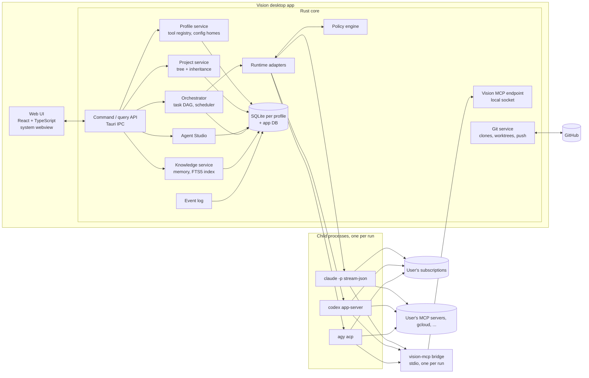
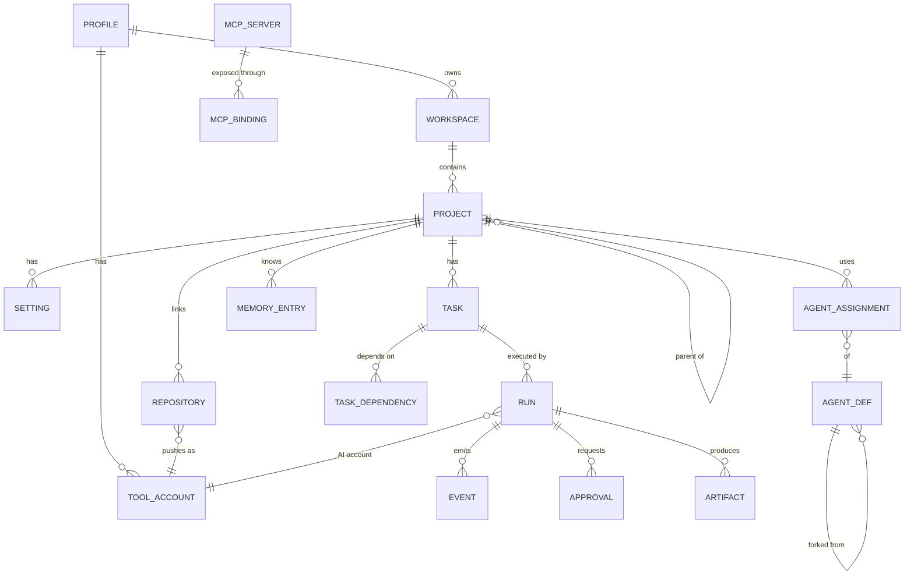

# Vision: implementation plan

- **Status:** Accepted by the product owner (Jakub), revision 3.1
- **Date:** 2026-11-13
- **Input:** product specification "Vision v0.2", the owner's decisions listed in §0, and an
  independent review of revision 2 (findings verified against the cited sources before
  being applied).
- **Scope:** architecture, technology choice with evidence, data model, profile and
  credential model, knowledge layer, roadmap with concrete milestones, risks and open
  questions. No implementation code.

Evidence convention (same as [`research.md`](research.md)): factual claims link to a
source. Claims without one are tagged `[no source: estimate]`,
`[no source: common convention]` or `[no source: to verify]`. Design choices are
labelled *[opinion]*. Statements about provider terms are my reading of the linked pages,
not legal advice.

---

## 0. Decisions already made

| # | Decision | Date |
| --- | --- | --- |
| D1 | **No API keys stored or offered by Vision.** Users sign in to their own subscriptions through the official CLIs (Claude Code, Codex, optionally Antigravity). | 2026-11-13 |
| D2 | **Account profiles** (e.g. Work, Personal), each with separate logins for AI CLIs, GitHub and any other tool (gcloud, cloud CLIs, MCP servers). | 2026-11-13 |
| D3 | **Profile sits above workspaces** (`Profile → Workspace → project tree`). | 2026-11-13 |
| D4 | **Desktop app for macOS, Windows and Linux; open source; nothing hosted.** | 2026-11-13 |
| D5 | **Tauri 2 with a Rust core, UI in React + TypeScript.** Speed matters more than language. | 2026-11-13 |
| D6 | **Agents and skills can be shared between profiles**, controlled by a user setting. | 2026-11-13 |
| D7 | **License: MIT.** | 2026-11-13 |
| D8 | **Antigravity allowed in one profile only** until per-profile login is documented. | 2026-11-13 |
| D9 | **UI similar to the Claude desktop app** in layout and feel, with Vision's own branding (§2.4). | 2026-11-13 |
| D11 | **Owner develops on macOS.** Live CLI tests run on macOS; Windows is covered by CI (replay tier, process-tree tests) until a Windows machine is available. | 2026-11-13 |
| D12 | **No written confirmation from providers.** The owner reviewed the providers' published terms and accepts risk R2 without emailing Anthropic or OpenAI (replaces the default for Q2). | 2026-11-13 |
| D10 | **All recommended defaults in §11 accepted** (questions 2-11, 13). Questions 1 (time budget) and 12 (plan tier) remain open and do not block M0. | 2026-11-13 |

### Changes from revision 2

- Generic **tool registry** per profile instead of a fixed list (gcloud, Azure, AWS, kubectl, custom CLIs, MCP servers) (§6.3).
- **Agents get no push credential**; Vision pushes and opens PRs after approval (§5.4).
- **Safe launch flags** that keep repository hooks, settings and MCP configs from running unless the user opts in (§3.5).
- **Run lifecycle and crash recovery** (§5.8), **launch compilation** from agent definition to CLI flags (§5.3), **adapter test strategy** (§5.9).
- **Windows specifics** (§8.1), **webview security** (§2.3), **persistence rules** (§4.5), **observability** (§8.2).
- Stronger knowledge-layer rules: hash-pinned approvals, digest budget, supersession (§7).
- **Roadmap reordered:** the first real agent run is milestone M2, a public 0.1 release comes before orchestration (§9).
- Corrections: `--bare` is announced as the future `-p` default; `claude -p` is the Agent SDK's CLI; Codex quote completed; `gh` keyring is not separated by config dir; subscription metering history added (§3.5, §10).

---

## 1. Summary of the recommendation

1. **A single desktop app:** Tauri 2, Rust core, React/TypeScript UI. One binary per OS,
   no bundled browser engine, no Node.js sidecar.
2. **Vision orchestrates the official CLIs; it is not a new agent.** Each run is a child
   process of the user's own `claude`, `codex` or `agy`, started with the profile's config
   directories and a git worktree, driven over the CLI's documented machine interface.
3. **Sign-in happens in each CLI's own flow, and Vision never touches the tokens.**
   Anthropic does not prevent "an end user from signing in to the unmodified Claude Code
   binary with their own Claude subscription", while third-party developers may not offer
   claude.ai login or "collect, store, or intermediate" its credentials
   ([Claude Code legal and compliance](https://code.claude.com/docs/en/legal-and-compliance)).
   OpenAI says local or open-source apps using app-server authentication "can continue
   using it", recommends migrating to Sign in with ChatGPT, and has never permitted it for
   commercial or hosted services ([Codex app-server](https://learn.chatgpt.com/docs/app-server.md)).
   Both are readings of current terms, tracked as risk R2.
4. **A profile is a set of separate config homes**, one per tool, plus git identity. Claude
   Code documents exactly this for work and personal accounts
   ([authentication](https://code.claude.com/docs/en/authentication)); gcloud, Azure CLI and
   AWS CLI have documented equivalents (§6.3).
5. **Two-layer safety.** Structural limits that do not depend on parsing commands (no push
   credential for agents, OS sandbox where the CLI provides one, repo config off by
   default), plus a per-call policy engine with approval cards (§5.4).
6. **Agents collaborate through a Vision MCP server** with capped delegation, never by
   sharing context (§5.5).
7. **A project knowledge layer:** agents propose decisions, conventions and lessons, the
   user approves them, child projects inherit them, a local full-text index makes them
   searchable (§7).
8. **Roadmap:** the riskiest part (driving the CLIs on Windows and Unix) is proven in the
   M0 spike and the first real run is M2; a public 0.1 ships at M7, before orchestration
   (§9).

---

## 2. Architecture



### 2.1 Components

| Component | Responsibility |
| --- | --- |
| **UI** | Screens from spec §11; talks to the core only through typed Tauri commands and an event channel. |
| **Profile service** | Profiles, tool registry, config homes, sign-in status, git identity (§6). |
| **Project service** | Workspaces, nested projects, move/reorder/archive, settings with inheritance and provenance (§4.3). |
| **Agent Studio** | Built-in templates (read-only), forks, versions, launch compilation (§5.1, §5.3). |
| **Orchestrator** | Tasks, task DAG, scheduling, limits, retries, cancel, recovery (§5.6, §5.8). |
| **Policy engine** | Per-call allow / deny / ask-human (§5.4). |
| **Runtime adapters** | Start a CLI, normalise its stream into Vision events, relay permission requests (§5.2). |
| **Vision MCP endpoint** | Collaboration and knowledge tools for runs, reached through a stdio bridge (§5.5). |
| **Git service** | Clones, worktrees, diffs; the only component that pushes or opens PRs (§5.7). |
| **Knowledge service** | Memory files, approval inbox, FTS5 index (§7). |
| **Event log** | Append-only events per run, plus compressed raw CLI streams (§4.4). |

### 2.2 Process model

- Agent work never runs in the app process. Each run is a child process in its own process
  group (Unix) or Job Object (Windows), so it can be stopped as a tree (§5.8).
- The core uses an async runtime with bounded concurrency per account and per tool.
- Perceived speed is dominated by the model and the CLI `[no source: estimate]`. Vision's
  own budget covers startup, navigation and stream rendering; targets are exit criteria in
  §9.

### 2.3 Webview security

The UI renders attacker-influenced text: model output, repository files, diffs, MCP tool
results. In Tauri, script running in the webview can call the IPC commands, which here can
start processes. Rules *[opinion]*:

- No remote content in the main webview; strict Content Security Policy, no inline script.
- Markdown rendered with raw HTML disabled and sanitised; links open in the system browser
  after confirmation.
- Tauri capabilities scoped per window to the commands that window needs; no generic
  "run command" or "read file" IPC.
- Terminal output only through the terminal widget.

### 2.4 UI design direction

The owner wants a look and feel **similar to the Claude desktop app**: calm, content-first,
conversation-centred (D9). Vision takes the *interaction patterns*, not the brand: its own
name, logo, colour palette and open-source fonts, and no Anthropic logos, icons or trademarks,
which the terms do not allow in a product's own branding
([legal and compliance](https://code.claude.com/docs/en/legal-and-compliance)). *[opinion on
the specific layout below]*

| Area | Pattern |
| --- | --- |
| **Left sidebar** | Profile switcher at the top (name + colour); primary navigation (Home, Projects, Agents, Tasks, Knowledge, Settings); the project tree with expand/collapse; recent runs underneath, like a conversation list. Collapsible to icons. |
| **Main column** | A run or task reads like a conversation: agent messages as text, tool calls as collapsed cards (expand for input/output), approval cards inline with Allow / Deny, a composer at the bottom to start a task with agent, model and project pickers. Centred, readable line length. |
| **Right panel** | Opens on demand for diffs, files, artifacts, the task graph and memory proposals, similar to a side artifact panel; resizable, closable. |
| **Visual style** | Warm neutral surfaces, one accent colour per profile, generous spacing, rounded corners, subtle borders instead of heavy shadows, a readable sans-serif for UI and a monospace for code; light and dark themes following the OS (spec §11). |
| **Interaction** | Keyboard-first: command palette (Ctrl/Cmd+K), shortcuts for new task, profile switch, sidebar toggle; streaming text without layout jumps; every state designed (loading, empty, error, success, disabled). |
| **Accessibility** | WCAG 2.2 AA: keyboard operable, visible focus, 4.5:1 text contrast, labelled inputs ([`.claude/rules/frontend.md`](../.claude/rules/frontend.md), [WCAG 2.2](https://www.w3.org/TR/WCAG22/)). |

Implementation: design tokens (colours, spacing, radii, typography) as CSS custom properties
in one theme file; a small component library (Sidebar, TreeItem, MessageItem, ToolCallCard,
ApprovalCard, Composer, Panel, CommandPalette) built first in M0 and reused everywhere.

---

## 3. Technology selection

Criteria, in order: (1) the integration surface we need (subprocess protocols, process
trees, PTY, git, OS keychain), (2) speed and memory with many child processes, (3) packaging
for macOS, Windows and Linux, (4) maintainability, (5) contributor friendliness.

### 3.1 Why the CLIs, not an SDK library

Because of D1, Vision drives the user's own `claude` binary instead of embedding the Agent
SDK library with an API key. Note that Anthropic documents `claude -p` itself as "the
Agent SDK via the CLI" ([headless](https://code.claude.com/docs/en/headless.md)), and its
developer clause says products using the Agent SDK should use API keys
([legal and compliance](https://code.claude.com/docs/en/legal-and-compliance)). Vision
relies on the end-user carve-out quoted in §1 and on never collecting, storing or
intermediating credentials. That is an interpretation; the page directs such questions to
Anthropic. The owner decides whether to ask in writing (Q2).

With the CLIs, every runtime is a language-neutral subprocess protocol, which is why the
core language is free to optimise for speed (D5).

### 3.2 Core language and desktop shell (decided: D5)

| Option | Evidence | Assessment |
| --- | --- | --- |
| **Tauri 2 + Rust core** (chosen) | System webview, minimal app "can be less than 600KB" ([Tauri](https://v2.tauri.app/start/)); MCP Rust SDK is Tier 1 ([MCP SDKs](https://modelcontextprotocol.io/docs/sdk)); OS credential stores on all three platforms via the `keyring` crate ([keyring](https://docs.rs/crate/keyring/3.6.3/source/README.md)) | Smallest footprint, one process tree. Slower to write than TypeScript. |
| Tauri 2 + Node.js sidecar | Sidecar packaged as a binary per target, e.g. with `pkg` ([Tauri: Node.js sidecar](https://v2.tauri.app/learn/sidecar-nodejs/)) | Fallback if Rust slows the project (R9). |
| Electron + TypeScript | Node.js main process, one renderer per window ([Electron process model](https://electronjs.org/docs/latest/tutorial/process-model)) | Mature tooling, larger download and memory `[no source: common convention]`. |

Risks checked in the M0 spike: webview differences (WebKitGTK, WebView2, WKWebView)
`[no source: common convention]`, Rust learning curve, Windows process and PTY behaviour
(§8.1).

### 3.3 Frontend

React + TypeScript + Vite; virtualized tree for the sidebar; graph view for DAGs; TypeScript
types generated from the Rust command definitions so UI and core cannot drift. React for its
ecosystem, not for speed `[no source: common convention]`. *[opinion]*

### 3.4 Storage

- **SQLite in WAL mode.** Readers and the writer do not block each other, one writer at a
  time, WAL does not work on network filesystems, and the `-wal` file must be kept with the
  database when it is copied ([SQLite WAL](https://www.sqlite.org/wal.html)). The core is the
  only writer and files live on local disk.
- **One database per profile plus a small app database** (profiles list, shared library
  index, settings), so exporting or deleting a profile is a file operation and a Work export
  never contains Personal data. *[opinion]*
- **Hierarchy:** adjacency list plus materialized path; recursive CTEs for ancestor walks
  ([SQLite WITH clause](https://www.sqlite.org/lang_with.html)).
- **Full-text search:** SQLite FTS5 with BM25 ranking ([SQLite FTS5](https://www.sqlite.org/fts5.html)).
- Persistence rules (migrations, source of truth, retention, redaction) in §4.5.

### 3.5 Runtimes

| Runtime | Interface | Sign-in | Per-profile isolation | Permission hand-off |
| --- | --- | --- | --- | --- |
| **Claude Code** | `claude -p --input-format stream-json --output-format stream-json` with session resume ([headless](https://code.claude.com/docs/en/headless.md), [CLI reference](https://code.claude.com/docs/en/cli-reference.md)) | `claude auth login`, Anthropic's browser flow; `claude auth status` returns JSON with `authMethod` and `configDirectory` ([CLI reference](https://code.claude.com/docs/en/cli-reference.md)) | `CLAUDE_CONFIG_DIR`: own settings, history and claude.ai login per directory; macOS Keychain entry keyed to it ([authentication](https://code.claude.com/docs/en/authentication)) | `--permission-prompt-tool` (an MCP tool) or a `PermissionRequest` hook ([headless](https://code.claude.com/docs/en/headless.md)) |
| **Codex** | `codex app-server`: JSON-RPC over stdio, `initialize` then `initialized` per connection, threads/turns/items ([app-server](https://learn.chatgpt.com/docs/app-server.md)) | ChatGPT sign-in in browser or device code (`codex login --device-auth`) ([Codex auth](https://learn.chatgpt.com/docs/auth.md)) | `CODEX_HOME`; with `cli_auth_credentials_store = "file"` credentials are in `auth.json` under it ([Codex auth](https://learn.chatgpt.com/docs/auth.md)) | Approval requests: `accept`, `acceptForSession`, `decline`, `cancel` ([app-server](https://learn.chatgpt.com/docs/app-server.md)) |
| **Antigravity** (one profile, D8) | `agy acp` over stdio ([Antigravity ACP](https://antigravity.google/docs/cli/acp.md)); `agy -p --output-format stream-json` ([headless](https://antigravity.google/docs/cli/headless.md)) | Interactive `agy` or `agy acp --login` ([ACP](https://antigravity.google/docs/cli/acp.md)) | Not documented; config under `~/.gemini/antigravity-cli/` ([headless](https://antigravity.google/docs/cli/headless.md)) | ACP `session/request_permission` ([ACP overview](https://agentclientprotocol.com/protocol/v2/overview)) |

**Claude Code launch rules:**

- **Never `--bare`.** Bare mode "never reads OAuth credentials or the system keychain"
  ([headless](https://code.claude.com/docs/en/headless.md)).
- **`--bare` is announced as the future default for `-p`:** "`--bare` is the recommended
  mode for scripted and SDK calls, and will become the default for `-p` in a future
  release" ([headless](https://code.claude.com/docs/en/headless.md)). The adapter reads the
  effective mode from the `system/init` event and fails with a clear message if a run is
  bare; M0 records how to opt out. If no opt-out ships, the fallback is driving background
  sessions (`claude --bg`, `claude logs`, `claude attach`, [CLI reference](https://code.claude.com/docs/en/cli-reference.md)).
  Tracked as R10.
- **Repository config is off by default.** Without `--bare`, a `-p` run loads the
  project's hooks, settings and `.mcp.json` without a trust prompt
  ([headless](https://code.claude.com/docs/en/headless.md)). Default flags:
  `--setting-sources user` (load only the profile's user settings),
  `--strict-mcp-config --mcp-config <per-run file>` (only Vision-chosen MCP servers)
  ([CLI reference](https://code.claude.com/docs/en/cli-reference.md)), and hooks disabled
  through `--settings` `[no source: to verify that project settings cannot re-enable hooks
  when they are not loaded]`. Project config can be enabled per repository, pinned to a
  content hash, and is re-prompted when the hash changes. Same principle for Codex project
  config and ACP agents.
- **Limits per run:** `--max-turns`, and `--max-budget-usd` as a guard on the client-side
  estimate ([CLI reference](https://code.claude.com/docs/en/cli-reference.md)).
- **Do not bundle the CLIs.** Users install them; Vision detects versions and links to the
  official installers. Running them unmodified with every built-in sign-in method intact is
  a stated condition for running Claude Code in a product
  ([legal and compliance](https://code.claude.com/docs/en/legal-and-compliance)); see
  §6.7 for how Vision avoids "restricting" methods.

**Codex notes:** app-server publishes per-version JSON schemas and exposes ChatGPT rate
limits through `account/rateLimits/read`; its WebSocket transport is experimental
([app-server](https://learn.chatgpt.com/docs/app-server.md)). Vision uses stdio and may
host several threads in one app-server process per profile; decided in M6.

**ACP is generic:** over 60 agents speak it ([zed.dev/acp](https://zed.dev/acp)), so the
Antigravity adapter also opens the door to others later.

### 3.6 MCP

- **Users' MCP servers are attached by the CLI that runs the agent.** Vision writes a
  per-run MCP config with only the servers the agent may use (spec §6: no automatic access).
  OAuth tokens for remote servers stay inside each CLI's per-profile config directory; for
  Claude Code the user authorises with `claude mcp login <name>` under the profile's
  `CLAUDE_CONFIG_DIR` ([CLI reference](https://code.claude.com/docs/en/cli-reference.md)).
- **stdio MCP servers inherit the run's environment**, so a server that shells out to
  gcloud or AWS uses the profile's tool accounts (§6.3) `[no source: common convention for
  child processes; verify per CLI that env is passed to MCP servers]`.
- Vision runs its own MCP endpoint (§5.5) and an MCP client for health checks and tool
  discovery, on the official Rust SDK.
- Revision 2026-07-28 makes the protocol stateless and hardens authorization; its SDKs were
  betas whose APIs "may change" ([MCP blog](https://blog.modelcontextprotocol.io/posts/sdk-betas-2026-07-28/)).
  Vision wraps the SDK behind its own interface, pins exact versions, and does not build on
  beta SDKs.

### 3.7 Prior art

Parallel-agent tools built on one worktree per agent already exist: Emdash, Claude Squad,
Vibe Kanban, Agent Orchestrator, Conductor and others
([Augment Code overview, 2026](https://www.augmentcode.com/tools/open-source-agent-orchestrators)).
None listed there is described as combining nested projects with inheritance, an agent
studio, per-profile account isolation and a project knowledge layer. Before M5, spend a day
with two of them to confirm the gap and borrow worktree UX. *[opinion, based on that
overview only]*

---

## 4. Domain and data model

### 4.1 Hierarchy

```
Vision app (one per OS user)
├── App DB: profiles, shared library index, app settings
└── Profile (Work, Personal, ...)            ← isolation boundary, own DB file
    ├── Tool accounts (Claude Code, Codex, gh, gcloud, az, aws, custom...): one config home each
    ├── Git identity (name, email, signing key, SSH key)
    └── Workspace (one or more)
        ├── Project tree (unbounded depth)
        ├── Agent library, MCP server configs, skills (profile scope)
        └── Knowledge (per project, §7)
Shared library (app scope): built-in agents, shared agents, skills, workflow templates
```

### 4.2 Entities



| Entity | Key fields | Notes |
| --- | --- | --- |
| `profile` (app DB) | id, name, color, icon, kind (`work`, `personal`, `other`), db_path | |
| `tool_account` | id, tool (registry id), config_home, login_label, last_status, last_checked_at | **No tokens.** Several per tool allowed (e.g. two GitHub accounts). |
| `git_identity` | author name, email, signing key ref, ssh key path | Per profile, overridable per repository |
| `workspace` | id, name, settings | |
| `project` | id, workspace_id, parent_id, path, sort_key, name, archived_at | |
| `setting` | project_id, category, mode (`inherit`, `override`, `disable`), payload, removed_keys | §4.3 |
| `repository` | id, project_id, git_account_id, remote_url, default_branch, clone_path, setup_command, copy_files[] | One clone per repository per profile |
| `agent_def` | id, scope (`builtin`, `shared`, `profile`, `project`), based_on_id, version, file_path, content_hash | File is canonical (§4.5) |
| `agent_assignment` | project_id, agent_def_id, overrides, inherited_from | |
| `mcp_server` | id, scope, transport, command or url, env template, secret refs | Config only |
| `mcp_binding` | target (project or agent), mcp_server_id, tool_allowlist | Default no access |
| `skill`, `skill_binding` | file_path, content_hash, scope, assignment | |
| `task` | id, project_id, parent_task_id, title, spec, status, budget | |
| `task_dependency` | task_id, depends_on_id | Edge table: readiness queries, cycle check |
| `run` | id, task_id, agent_def_id + version, tool, ai_account_id, worktree_path, branch, status, pid, process_start_time, cli_session_id, usage, started_at, ended_at | Fields for recovery (§5.8) |
| `event` | run_id, seq, ts, type, payload | Append-only; size cap per run |
| `approval` | run_id, action, target, risk, status, created_at, decided_at | Survives restart (§5.8) |
| `artifact` | run_id, kind (diff, file, report, PR), ref | |
| `memory_entry` | id, project_id, kind, status (`proposed`, `active`, `superseded`, `retired`), supersedes, file_path, content_hash, source_run_id | §7 |
| `idea` | id, text, project_id?, created_at, task_id? | §7.3 |
| `audit_log` | ts, actor, action, target, result | Separate from events |

### 4.3 Inheritance resolver

One `setting` row per category: instructions, coding standards, MCP bindings, agent
assignments, skills, knowledge, permissions.

| Mode | Meaning |
| --- | --- |
| `inherit` | Parent's effective value, plus local additions, minus `removed_keys` |
| `override` | Only the local value |
| `disable` | Empty here and for inheriting children |

Lists merge as **union minus removals**, scalars as **nearest wins**, text is
**concatenated root to leaf** under headings naming the source project, within a size budget
shared with the memory digest (§7.1). Every value carries **provenance** (`local` or
`inherited from DataBrain`) shown as a badge (spec §3.1). Results are cached per project and
invalidated by subtree. Inheritance never crosses a profile. *[opinion]*

### 4.4 Event log

Adapters map CLI streams into typed events (`message`, `tool_call`, `tool_result`,
`file_change`, `command`, `approval_requested`, `usage`, `status`). Events are written to
SQLite before the UI shows them, and batched to the UI (e.g. every 50 ms)
`[no source: estimate]`. Partial-message deltas are rendered live but not persisted. The raw
CLI stream is kept as a compressed file per run for debugging and as test fixtures (§5.9).

### 4.5 Persistence rules

- **Migrations:** forward-only, numbered, tracked in `PRAGMA user_version`; the database is
  checkpointed and copied before any migration; an older build refuses to open a newer
  schema with a clear message. *[opinion]*
- **Files are canonical** for agent definitions, skills, instructions, workflow templates and
  memory; the database holds an index rebuilt from files. Each file's frontmatter carries
  `schema_version`. Edits made outside Vision are detected by content hash.
- **Retention:** raw streams kept 30 days by default (setting); events capped per run;
  `audit_log` kept until the profile is deleted.
- **Redaction** before persistence and before diagnostic export: known secret values from
  the keychain-backed store and common token patterns are masked. *[opinion]*
- **Durability:** approvals and audit writes use `synchronous=FULL`; other writes may use
  `NORMAL`, accepting loss of the last transactions on power failure
  ([SQLite WAL](https://www.sqlite.org/wal.html)).

---

## 5. Agents, runtimes and orchestration

### 5.1 Agent definition

A versioned Markdown file with YAML frontmatter (aligned with Claude Code subagent files
where fields overlap, [`research.md`](research.md) §1). Fields follow spec §4.3:

- identity: name, slug, description, icon, role, specialization
- instructions: system prompt, rules, responsibilities, constraints, output format
- runtime: **tool** (`claude_code`, `codex`, `antigravity`, or `any` with a preference
  order), model, effort, limits (turns, wall time)
- tools: MCP server refs with tool allowlists, skill refs, other tool accounts it may use
  (e.g. `gcloud`)
- permissions: filesystem, shell (deny / allowlist / ask), git (read, commit; push is never
  granted directly, §5.4), deploy, approval rules
- collaboration: may delegate, may contact, may request review, may create subtasks

An agent names a **tool**, never an account; the account comes from the run's profile.
The same "Senior Developer" runs on the Work login in a Work project and on the Personal
login in a Personal project. A missing account fails fast with a clear message.

**Built-ins:** v0.1 ships 4 templates (Engineering Manager, Senior Developer, Code Reviewer,
QA Engineer); the other 8 from spec §4.1 follow on demand. Editing a built-in creates a fork
with `based_on_id` and a diff view.

### 5.2 Runtime adapter interface

```
detect() -> { version, capabilities }      // from system/init, generated schema, --version
start(runSpec) -> RunHandle                // spawn: allowlisted env, cwd = worktree
events(RunHandle) -> stream<Event>
respond(RunHandle, approvalDecision)
steer(RunHandle, message)                  // where supported (Codex turn/steer)
interrupt(RunHandle), resume(sessionRef)   // protocol-level first, signals as fallback
```

Capability flags tell the UI which controls to show (spec §10: *supported* executions).
Capability detection uses the `capabilities` array in Claude Code's `system/init`
([headless](https://code.claude.com/docs/en/headless.md)) and Codex's per-version schema
([app-server](https://learn.chatgpt.com/docs/app-server.md)), not version string
comparison. Parsers ignore unknown event types and log them once.

### 5.3 Launch compilation

How each agent field reaches each CLI. Fields a runtime cannot honour are shown as warnings
in Agent Studio. Deliverable of M2 (Claude) and M6 (Codex).

| Agent field | Claude Code | Codex | Antigravity |
| --- | --- | --- | --- |
| Instructions | `--append-system-prompt-file <run>/instructions.md` ([CLI reference](https://code.claude.com/docs/en/cli-reference.md)) | thread instructions on `thread/start` `[no source: to verify parameter name]` | `[no source: to verify]` |
| Model, effort | `--model`, `--effort` ([CLI reference](https://code.claude.com/docs/en/cli-reference.md)) | thread/turn parameters `[no source: to verify]` | `[no source: to verify]` |
| Turn limit | `--max-turns` | Vision counts turns and interrupts | Vision counts turns |
| MCP servers | `--strict-mcp-config --mcp-config <run>/mcp.json` | per-run config under the run's `CODEX_HOME` overlay `[no source: to verify]` | ACP `session/new` MCP list `[no source: to verify]` |
| Skills | `--plugin-dir <run>/plugin` containing the skills, so nothing is written into the worktree ([CLI reference](https://code.claude.com/docs/en/cli-reference.md)) | `AGENTS.md`-style instructions appended | Appended to instructions |
| Tools allow/deny | `--allowedTools`, `--disallowedTools`, `--tools` ([CLI reference](https://code.claude.com/docs/en/cli-reference.md)) | sandbox mode + approval policy | ACP permission handling |
| Subagents | `--agents <run>/agents.json` ([CLI reference](https://code.claude.com/docs/en/cli-reference.md)) | Not mapped in v1 | Not mapped |

Resumed Claude sessions keep the system prompt recorded on the first request until
compaction ([CLI reference](https://code.claude.com/docs/en/cli-reference.md)), so a changed
agent definition applies to new runs, and the UI says so.

### 5.4 Safety: structural limits first, policy second

**Layer 1, structural (does not rely on parsing commands):**

- **Agents get no push credential.** Agent runs do not have the git credential helper or a
  `GH_TOKEN`. Push, PR creation, branch deletion and merge are Git-service actions that
  agents request through `vision.request_push` / `vision.open_pr`, gated by an approval card
  that shows the target account and diff. *[opinion; owner decision Q4]*
- **OS sandbox where the CLI provides one**, with the worktree as the only writable root
  (Claude Code sandbox settings, Codex sandbox modes) `[no source: to verify exact settings
  per CLI in M0]`.
- **Repository config off by default** (§3.5).
- **Allowlisted environment** (§6.6).

**Layer 2, per-call policy (best effort):**

| Runtime | Hook |
| --- | --- |
| Claude Code | `--permission-prompt-tool` on the Vision bridge, or a `PermissionRequest` hook ([headless](https://code.claude.com/docs/en/headless.md)) |
| Codex | app-server approval requests ([app-server](https://learn.chatgpt.com/docs/app-server.md)) |
| ACP | `session/request_permission` ([ACP](https://agentclientprotocol.com/protocol/v2/overview)) |

The policy engine combines agent, project and profile rules into allow, deny or ask-human.
It only sees calls the CLI asks about; reads inside the working directory and read-only
commands usually do not reach it ([headless](https://code.claude.com/docs/en/headless.md)),
so Layer 2 is documented as best effort. Every decision goes to `audit_log`.

### 5.5 Vision MCP endpoint

- **Transport:** each run gets a small `vision-mcp` bridge over stdio, which connects to the
  core through a Unix domain socket or a Windows named pipe with a user-only ACL. No TCP
  listener, so no browser can reach it. *[opinion]*
- **Per-run token** passed in the bridge's environment, expiring with the run.
- **Tools:**

| Tool | Purpose |
| --- | --- |
| `vision.create_subtask(title, spec, agent?, depends_on?)` | Delegation |
| `vision.request_review(artifact, reviewer?)` | Review workflow |
| `vision.request_push(branch)`, `vision.open_pr(title, body)` | Push and PR via approval (§5.4) |
| `vision.report_blocker(reason)`, `vision.ask_human(question)` | Escalation |
| `vision.publish_artifact(kind, ref, summary)` | Results and findings |
| `vision.get_task(id)`, `vision.get_artifact(id)` | Context by reference |
| `vision.search(query, scope)`, `vision.get_doc(id)` | Knowledge (§7.2) |
| `vision.propose_memory(kind, text, evidence)` | Memory proposals (§7.1) |
| `vision.permission_prompt(...)` | Claude Code permission hand-off only |

- **Delegation limits:** a subtask's permissions are the intersection of the parent run's
  and the requested agent's; delegation depth, children per task and runs per task tree are
  capped (defaults 2 / 5 / 15). *[opinion]*
- **Agent-written text is data:** task specs, artifacts, review comments and search results
  from other agents arrive with provenance labels, never as instructions.

### 5.6 Orchestration modes and limits

- **Autonomous:** the Engineering Manager builds the task DAG with `vision.create_subtask`;
  the scheduler runs ready tasks within limits.
- **Workflow:** stored DAG templates (§7.5); same scheduler.
- **Subscription limits, not money.** Advertised Pro and Max limits "assume ordinary,
  individual usage of Claude Code and the Agent SDK"
  ([legal and compliance](https://code.claude.com/docs/en/legal-and-compliance)), and
  multi-agent systems used about 15x the tokens of chats in Anthropic's research system
  ([Anthropic Engineering](https://www.anthropic.com/engineering/multi-agent-research-system)).
  Defaults: 2 parallel runs per account `[no source: estimate]`, a per-day run cap, a global
  **Pause all runs** button, and automatic pause of an account's queue when its CLI reports a
  rate limit (Claude Code `api_retry` with `rate_limit`,
  [headless](https://code.claude.com/docs/en/headless.md)).

### 5.7 Git and worktrees

- **One clone per repository per profile**, bound to one GitHub account at clone level (§6.4).
- **One worktree per write-capable run** on `vision/<task-id>/<agent-slug>`; git refuses to
  check out one branch in two worktrees
  ([git-worktree](https://www.kernel.org/pub/software/scm/git/docs/git-worktree.html)).
- **Worktree setup:** per-repository setup command (e.g. `pnpm install`, `uv sync`) and a
  list of untracked files to copy (e.g. `.env`), inherited through the project tree.
- **Cleanup:** worktrees removed after merge or after N idle days, never while a run is
  interrupted; a "stale worktrees" view; configurable short root path (§8.1).
- **Integration conflicts** create a task assigned to the human by default.
- Read-only agents get a worktree too; "read-only" is enforced by the sandbox where available,
  not by convention.

### 5.8 Run lifecycle and recovery

- Spawn each run in its own process group (Unix) or a Job Object with kill-on-close
  (Windows) `[no source: common convention]`.
- Store pid, process start time and CLI session id as soon as `system/init` or
  `thread/start` arrives.
- **Interrupt** through the protocol first (stdin close / `turn/interrupt`), then signals.
  Claude Code exits with 143 on SIGTERM and leaves the turn unfinished; SIGINT ends the turn
  ([headless](https://code.claude.com/docs/en/headless.md)).
- **On startup the core reconciles:** runs marked running whose process is gone become
  `interrupted`; orphans are terminated; pending approvals are shown again.
- **Resume:** `claude -p --resume <session-id>` (optionally
  `CLAUDE_CODE_RESUME_INTERRUPTED_TURN=1`) ([headless](https://code.claude.com/docs/en/headless.md));
  Codex `thread/resume` ([app-server](https://learn.chatgpt.com/docs/app-server.md)).
- **v1: runs stop when the app quits** (Q7). Background operation needs a supervisor and
  is a later decision.

### 5.9 Adapter testing

- **Replay tier (CI, every commit):** recorded raw streams are the fixture format; a fake CLI
  binary replays stdout with timing and reads stdin; golden files assert the normalised
  events. Fixtures are scrubbed of secrets and prompts before commit. *[opinion]*
- **Live tier (local, `make e2e-live`, before each release and when a CLI updates):** fixed
  scenarios per runtime (start, tool call, approval allow/deny, cancel, resume, rate limit,
  expired login) against the installed CLI; also re-records fixtures.
- **Compatibility:** Vision stores a tested version range per CLI; outside it the UI shows
  "untested version" and still runs. Because CLIs auto-update independently, the app checks a
  small signed compatibility manifest in the GitHub repository (the only network call Vision
  makes besides update checks).

---

## 6. Profiles and account isolation

### 6.1 Placement and sharing (decided: D3, D6)

Profiles sit above workspaces; switching profile switches the whole visible context, like
browser profiles.

**Sharing** is an app setting: with the shared library on, profiles can use shared agents,
skills and workflow templates; each item can be published to the shared library or kept in
its profile. Publishing strips profile-specific bindings (MCP servers, repositories, tool
accounts) and shows the full content for confirmation, because prompts and skills can contain
employer material. Default for a profile of kind `work`: open (Q5).

### 6.2 Profile directory

```
<local app data>/Vision/profiles/<short-id>/     (non-roaming, excluded from sync and export)
├── profile.db
├── tools/
│   ├── claude/   → CLAUDE_CONFIG_DIR
│   ├── codex/    → CODEX_HOME   (config.toml: cli_auth_credentials_store = "file")
│   ├── gh/       → GH_CONFIG_DIR (sign-in with --insecure-storage, see §6.4)
│   ├── gcloud/   → CLOUDSDK_CONFIG
│   ├── azure/    → AZURE_CONFIG_DIR
│   ├── aws/      → AWS_CONFIG_FILE, AWS_SHARED_CREDENTIALS_FILE
│   └── <custom>/ → user-defined variable(s)
└── runs/<run-id>/ → per-run instructions, MCP config, plugin dir, raw stream
```

On Windows and Linux, CLI logins in these directories are plain files (Claude Code
`.credentials.json`, [authentication](https://code.claude.com/docs/en/authentication); Codex
`auth.json`, [Codex auth](https://learn.chatgpt.com/docs/auth.md)). The directory is created
with user-only permissions, lives under a non-roaming path, and is never included in exports
or diagnostics.

### 6.3 Tool registry

Every external tool is a registry entry; built-in presets plus user-defined ones.

| Field | Meaning |
| --- | --- |
| `id`, `name`, `binary` | e.g. `gcloud`, resolved on PATH |
| `config_env` | Variable(s) that point the tool at the profile's directory |
| `login_command` | Run in a terminal with the profile environment |
| `status_command` | Run to verify which account is active |
| `clear_env` | Variables that would override the profile login and must not leak in |

| Preset | Isolation variable | Source |
| --- | --- | --- |
| Claude Code | `CLAUDE_CONFIG_DIR` | [Claude Code authentication](https://code.claude.com/docs/en/authentication) |
| Codex | `CODEX_HOME` | [Codex auth](https://learn.chatgpt.com/docs/auth.md) |
| GitHub CLI | `GH_CONFIG_DIR` | [gh environment](https://cli.github.com/manual/gh_help_environment) |
| Google Cloud CLI | `CLOUDSDK_CONFIG` ("the config directory can be changed by setting the environment variable"); named configurations via `CLOUDSDK_ACTIVE_CONFIG_NAME` | [gcloud configurations](https://docs.cloud.google.com/sdk/docs/configurations) |
| Azure CLI | `AZURE_CONFIG_DIR` | [Azure CLI configuration](https://learn.microsoft.com/cli/azure/azure-cli-configuration) |
| AWS CLI / SDKs | `AWS_CONFIG_FILE`, `AWS_SHARED_CREDENTIALS_FILE` | [AWS shared config location](https://docs.aws.amazon.com/sdkref/latest/guide/file-location.html) |
| kubectl | `KUBECONFIG` | `[no source: to verify]` |
| Antigravity | none documented → one profile only (D8) | [headless](https://antigravity.google/docs/cli/headless.md) |
| Custom | user enters variable, login and status commands | n/a |

Not yet verified per tool: whether credentials (for example Google application default
credentials) actually live under the relocated directory `[no source: to verify per preset
in M1]`. A preset becomes "verified" only after the two-profile test in M1 passes for it.

**How tools reach agents:** an agent lists the tool accounts it may use (§5.1); only those
config variables enter the run's environment. stdio MCP servers started by the CLI inherit
that environment (§3.6), so a BigQuery MCP server in the Work profile uses the Work gcloud
login.

### 6.4 GitHub and git

- **Clone-level binding**, so the right account is used even when the user runs git from
  their own terminal or IDE `[no source: common convention for git config precedence]`:

```
credential.https://github.com.helper =            # empty: reset inherited helpers
credential.https://github.com.helper = !GH_CONFIG_DIR='<profile>/tools/gh' gh auth git-credential
user.name / user.email / user.signingkey / commit.gpgsign   (from the profile)
core.sshCommand = ssh -i <profile key> -o IdentitiesOnly=yes   (SSH remotes)
```

  Git supports per-URL helpers and an empty value resets the list
  ([gitcredentials](https://git-scm.com/docs/gitcredentials/2.50.0)).
- **gh keyring caveat:** by default `gh` stores the token in the system credential store
  ([gh auth login](https://cli.github.com/manual/gh_auth_login)); the independent review
  found in the gh source that the keyring entry is keyed by host and username, not by
  config directory `[to verify in M1]`. Vision therefore signs in with
  `gh auth login --insecure-storage` ("save authentication credentials in plain text instead
  of credential store", [gh auth login](https://cli.github.com/manual/gh_auth_login)) so the
  token stays inside the profile directory, handled like other CLI credential files (§6.2).
- **Pre-push check:** before every push the Git service confirms that the active `gh`
  account equals the repository's bound account.
- **Agent runs never get this helper** (§5.4).

### 6.5 Sign-in flow

1. Profile → Tools → "Sign in to Claude Code".
2. Vision opens the **system terminal** with the profile environment and runs
   `claude auth login`. Anthropic's page handles the login; any code the user pastes goes
   into the CLI, not into Vision. Recommended over an embedded terminal because the review
   flagged that an embedded one passes the auth code through Vision's process (Q3).
   *[opinion]*
3. Vision runs `claude auth status` and checks `authMethod` = `claude.ai` and
   `configDirectory` = the profile directory
   ([CLI reference](https://code.claude.com/docs/en/cli-reference.md)). It stores only a
   label and the time of the check, in the profile database.
4. Same pattern for `codex login`, `gh auth login --insecure-storage`, `gcloud auth login`,
   `az login`, `aws configure` and custom tools.

Vision does **not** use `claude setup-token`, because that would mean Vision storing a
long-lived subscription token.

### 6.6 Environment allowlist

A run's environment is **built from an allowlist**, not by deleting known variables: PATH,
HOME/USERPROFILE, TEMP, locale, proxy variables, the config variables of the tool accounts
the agent may use, and the per-run bridge token. *[opinion]* This automatically keeps out
overriding credentials such as `ANTHROPIC_API_KEY`, `ANTHROPIC_AUTH_TOKEN`,
`CLAUDE_CODE_OAUTH_TOKEN`, `CLAUDE_CODE_USE_BEDROCK/VERTEX/FOUNDRY` and `ANTHROPIC_PROFILE`,
which Claude Code ranks above a `/login` credential
([authentication](https://code.claude.com/docs/en/authentication)), and `GH_TOKEN`, which
takes precedence over stored gh credentials
([gh environment](https://cli.github.com/manual/gh_help_environment)).

After spawn, the adapter verifies the account (`claude auth status`, `gh auth status`) and
fails the run on a mismatch.

### 6.7 Users who need another sign-in method

Anthropic's conditions say a product running Claude Code may not "remove, disable, or
restrict any authentication method built into it (including ... the user's own API key)"
([legal and compliance](https://code.claude.com/docs/en/legal-and-compliance)). Vision stores
and offers no keys (D1), but to avoid restricting the CLI each profile has a **credential
source** setting: *profile login* (default, allowlisted environment) or *inherit environment*
for users whose organisation mandates an API key, Bedrock, Vertex or a gateway; in that mode
Vision passes those variables through unchanged and still stores nothing (Q6).

### 6.8 Limits of isolation

- Claude Code Console sign-ins without an API key are stored outside the config directory
  and are not separated by it ([authentication](https://code.claude.com/docs/en/authentication));
  Vision detects `authMethod` and warns.
- An agent runs as the same OS user. Without a working sandbox it could read another
  profile's directory; profiles protect against using the wrong account, and the sandbox
  (§5.4) is what protects against a malicious or prompt-injected agent. Until the sandbox is
  verified per OS, this is a documented limitation.

### 6.9 UX

Profile switcher top-left with shortcut; profile color as a thin window frame and on every
run card; runs keep their profile after a switch; per-profile tool panel showing signed in /
expired / not installed / unverified with Sign in and Install buttons; every push, PR and run
start shows the account it will use. *[opinion]*

---

## 7. Knowledge layer ("second brain" for projects)

A knowledge layer per project that agents read and propose to, that the user approves, and
that follows the tree's inheritance. Local and in plain files. *[opinion: scope and design]*

### 7.1 Project memory

| Kind | Example | Default location |
| --- | --- | --- |
| Decision | "Use dbt incremental models for Sklik" | `docs/adr/NNNN-<slug>.md` (reuses the repository's ADR folder if present) |
| Convention | "SQL keywords upper case, CTEs over subqueries" | `memory/conventions.md` |
| Lesson | "Meta Ads API paginates by cursor, never by offset" | `memory/lessons-learned.md` |
| Glossary | "ROAS = revenue / ad spend" | `memory/glossary.md` |
| Note | "Why Semantic Layer is a separate project" | `memory/notes/<slug>.md` |

Defaults follow this repository's own `memory/` and `docs/adr/` conventions
([`AGENTS.md`](../AGENTS.md)).

- **Propose, then approve.** `vision.propose_memory` puts a proposal in the **memory inbox**
  with its evidence (run, diff, test output). Approve, edit or reject. Proposals are capped
  per run (default 3) and de-duplicated against existing entries with FTS before they reach
  the inbox.
- **Hash-pinned approvals.** Only entries whose content hash matches an approved record are
  injected into runs. A memory file changed outside Vision (commit, merge, agent edit) shows
  as "modified, re-approve" and is excluded until reviewed.
- **Lifecycle:** `active`, `superseded` (with `supersedes`), `retired`.
- **Location:** in the repository (versioned, visible to teammates) or Vision-local (for
  projects without a repo or with an employer that does not want extra files). Default per
  profile kind (Q8).
- **Format:** Markdown with YAML frontmatter and `[[wiki-links]]`, readable in any Markdown
  editor; Obsidian compatibility `[no source: to verify]`.
- **Inheritance:** a child sees ancestors' memory with provenance badges; a parent's
  convention can be overridden locally.
- **Digest into runs:** hard budget (default 1 500 tokens `[no source: estimate]`); order:
  nearest project first, conventions, then decisions, then lessons, most recently confirmed
  first; each line carries its entry id so runs can cite it. The rest is reachable through
  search. Short always-loaded context follows the repository's own guidance that long
  instruction files reduce adherence ([`research.md`](research.md) §1, Memory).

### 7.2 Local search

- **Index:** FTS5 with BM25 ([SQLite FTS5](https://www.sqlite.org/fts5.html)); v1 indexes
  approved memory, knowledge docs and task specs. Artifacts and run summaries come later,
  because they feed agent-written text back to agents.
- Code is not indexed; agents search code with their CLI's own tools in the worktree.
- `vision.search` and `vision.get_doc`, scoped to the run's project path and profile.
- Semantic search with a local embedding model is a later option
  `[no source: to verify model size and speed]`.
- **Privacy:** the index never leaves the machine, but anything an agent reads from it goes
  to that agent's model provider as part of its context.

### 7.3 Idea inbox

Quick capture (global shortcut, tray) of a thought with an optional project; triage turns it
into a task with a workflow template and agent. Stored in the profile database, exportable as
Markdown. Ships after 0.1.

### 7.4 Usage overview

One panel across profiles: per account, runs in progress, recent usage, rate-limit hits.
Only what the CLIs report: Claude Code per-run usage, `total_cost_usd` (a client-side
estimate at API prices, shown as "API-equivalent estimate", never as cost) and `api_retry`
events ([headless](https://code.claude.com/docs/en/headless.md)); Codex
`account/rateLimits/read` ([app-server](https://learn.chatgpt.com/docs/app-server.md));
Antigravity `[no source: to verify]`. Vision never scrapes provider websites. Per-account
figures ship with M2/M6; the cross-profile panel after 0.1.

### 7.5 Workflow templates

Shareable DAG templates in files; agents declared by role so they work with forks.

| Template | Steps |
| --- | --- |
| Fix issue | Read issue → implement in worktree → review → QA → push/PR approval |
| Feature (test-first) | Plan → tests first → implement → parallel review → verify findings → PR, mirroring this repository's `/feature` pipeline ([`agent-workflow.md`](agent-workflow.md)) |
| Bug hunt | Reproduce → fix → regression test → review |
| Docs refresh | Update docs from recent merges → review |

---

## 8. Distribution and operations (no hosting)

- **Desktop builds** for macOS (Apple Silicon; Intel per Q9), Windows and Linux (AppImage and
  `.deb` first), published as GitHub Releases.
- **MIT license (D7).** Product name and logo must not use "Claude Code" or "Anthropic";
  plain-text "runs Claude Code" is allowed
  ([legal and compliance](https://code.claude.com/docs/en/legal-and-compliance)).
- **Prerequisites the user installs:** git, and any of the CLIs in §6.3. The first-run
  wizard detects them and links to official installers.
- **Code signing:** on macOS an unsigned, un-notarised download is blocked by Gatekeeper for
  normal users, not just warned about `[no source: common convention]`; Windows SmartScreen
  warns on unsigned builds `[no source: common convention]`. Budget decision in Q10.
- **Auto-update** through Tauri's updater, which needs its own signing key from the first
  updatable release `[no source: to verify in M0]`.
- **Data** stays local; export/import of a profile's projects, agents and memory as files
  (CLI credentials are never exported).

### 8.1 Windows specifics

Items from the review, to confirm in the M0 spike `[no source: common convention, verify on
Windows]`:

1. npm-installed CLIs are `.cmd` shims; resolve the real executable and quote arguments
   safely, prefer native installers.
2. Process trees need Job Objects; there is no SIGINT, so interruption goes through the
   protocol.
3. ConPTY differs from Unix PTYs; using the system terminal for sign-in (§6.5) avoids most of
   it.
4. Paths: worktrees plus `node_modules` exceed 260 characters; use a short configurable root
   (e.g. `C:\v\w\<id>`) and set `core.longpaths`.
5. Worktree removal fails while files are locked (antivirus, dev servers, editors): retry and
   show stale worktrees.
6. `core.autocrlf` differences make diffs noisy; set it per clone.
7. Git Credential Manager is often configured system-wide; the empty-helper reset (§6.4) is
   required.
8. WebView2 runtime availability on Windows 10.

### 8.2 Observability

Structured core log with rotation; per-run raw stream and stderr; a "copy diagnostics" action
that produces a redacted bundle (Vision, OS and CLI versions, recent log lines, run metadata
without prompts). **No telemetry.** Vision's own network calls are limited to the update
check and the compatibility manifest, both against GitHub, and both can be turned off (Q11).

---

## 9. Roadmap

Ordered so the risky part comes first and a usable 0.1 ships before orchestration. Each
milestone is split into `memory/features.json` items of at most a few days, each with its own
acceptance test ([`AGENTS.md`](../AGENTS.md) rule 2). Every exit criterion names the OSes it
was verified on: **Windows + one Unix required, the third best effort** (Q9). Time boxes
depend on Q1.

| Milestone | Spec phase | Scope | Exit criteria |
| --- | --- | --- | --- |
| **M0 Skeleton + spike** | 0 | `bootstrap-project` first (fills `TODO(bootstrap)` in `AGENTS.md`, `memory/`); Tauri app, Rust core, React UI; SQLite + migrations; CI building installers for 3 OSes. **Spike from Rust:** start `claude -p` stream-json with a non-default `CLAUDE_CONFIG_DIR` on a subscription login; permission request via `--permission-prompt-tool` held 5 minutes then allowed and denied; cancel mid-tool-call with no surviving child; resume by session id; safe flags suppress a repo hook and a repo `.mcp.json`; behaviour with expired login and rate limit; how to stay non-bare | All spike items pass on Windows and macOS or Linux; findings in ADRs (shell, core language, storage, runtime strategy). **If start, permission round-trip or resume fails on either OS, stop and revise the plan.** |
| **M1 Profiles (thin)** | 0 | Profiles, switcher, colors, per-profile DB; tool registry with Claude Code, `gh`, gcloud presets; sign-in via system terminal; status checks; environment allowlist; git identity | Two profiles signed in to different Claude and GitHub accounts; signing out of profile A leaves B signed in; with `ANTHROPIC_API_KEY` and `GH_TOKEN` exported in the parent shell, runs still use the profile login; gcloud preset passes the two-profile test or is marked unverified |
| **M2 First real run** | 3 | One flat project, one hard-coded agent; worktree with setup command; Claude adapter with launch compilation; event log + live stream; approval cards; cancel, resume, crash recovery; per-run usage | An agent fixes a seeded bug in a test repo; one approval allowed and one denied; a pending approval survives 30 minutes; killing the app mid-run leaves no orphan and Resume continues the same session; output containing `` and a `javascript:` link renders inert |
| **M3 Git + push as profile** | 1 | Clone-level binding; diff view; Vision-side push and PR with approval card; pre-push account check | Push to a private repo as Work and another as Personal; a push from a plain terminal in a Vision clone uses the bound account; an agent run cannot push |
| **M4 Project tree + inheritance** | 1 | Workspaces, nested projects, move/reorder/archive, settings with provenance, basic dashboard | 1 000-node tree with project switch under 100 ms p95 `[no source: estimate]`; moving a 200-node subtree updates a leaf's effective settings correctly; no cross-profile move without the rebind dialog |
| **M5 Agent Studio** | 2 | 4 built-in templates; create, duplicate, fork-on-edit; editor driven by the launch-compilation table; MCP, skill and tool-account assignment; permissions; import/export | Editing a built-in forks it; unsupported fields show warnings; export and re-import round-trips |
| **M6 Codex adapter** | 3 | `codex app-server` with approvals, steering, rate-limit read | The M2 scenario passes on Codex; no Claude-specific type in orchestrator or UI code |
| **M7 Release 0.1** | new | Signing decision executed, updater, first-run wizard, README, diagnostics bundle, compatibility manifest, replay-tier tests in CI | A non-developer installs 0.1 on Windows and macOS from GitHub Releases and completes the M2 scenario |
| **M8 Vision MCP + delegation** | 4 | Bridge and endpoint; `create_subtask`, `request_review`, `request_push`; delegation limits; two agents sequentially | A manager delegates to a developer and a reviewer; a manager exceeding the fan-out cap is stopped |
| **M9 Orchestration** | 4 | Parallel runs, workflow templates, rate-limit pausing, per-day caps, Pause all | Spec §16 acceptance scenario passes on the DataBrain sample project within a set number of runs and turns |
| **M10 MCP management** | 2-3 | Add stdio and HTTP servers per profile; per-run MCP config; health and tool discovery; keychain-backed env secrets | An agent without a binding cannot see a server; the same server works with different logins in two profiles |
| **M11 Project memory & search** | new | Memory inbox, hash-pinned approvals, digest, FTS5 index, `vision.search` | An approved lesson reaches the next run in a child project and is cited; a memory file edited outside Vision is not injected until re-approved |
| Later | 5 | Idea inbox, cross-profile usage panel, Antigravity / generic ACP adapter, semantic search, containers, visual workflow editor | Prioritised after M11 |

---

## 10. Risks

| # | Risk | Mitigation |
| --- | --- | --- |
| R1 | **Scope** is large for one developer | Order above; 4 built-in agents; inbox, usage panel, Antigravity after 0.1; time boxes (Q1) |
| R2 | **Provider terms** are read in Vision's favour but not confirmed (§1, §3.1, §6.7) | Never handle tokens; do not bundle or modify CLIs; keep all sign-in methods possible; terms checklist per release; no written confirmation, owner accepts R2 (D12); never offer a hosted or paid Vision |
| R3 | **Subscription usage limits** with parallel agents | Per-account concurrency, daily caps, rate-limit pause, Pause all |
| R4 | **CLI churn** breaks adapters | Capability detection, unknown-event tolerance, replay and live tiers, compatibility manifest |
| R5 | **Repository content executes code** in non-bare runs | Repo config off by default, hash-pinned opt-in (§3.5) |
| R6 | **Prompt-injected agent** reads other profiles or exfiltrates | No push credential, sandbox, allowlisted env, delegation intersection, provenance labels; documented limitation until sandbox verified (§6.8) |
| R7 | **MCP protocol churn** | Wrapper, pinned versions, no beta SDKs |
| R8 | **Webview and Windows differences** | Spike on Windows, §8.1, Windows + one Unix per milestone |
| R9 | **Rust slows development** | If M0 + M1 take more than twice their time box, switch the core to a Node.js sidecar before M3 |
| R10 | **`-p` defaults to bare mode** and loses subscription login ([headless](https://code.claude.com/docs/en/headless.md)) | Detect from `system/init`; record opt-out in M0; background-session fallback |
| R11 | **Programmatic use gets metered separately.** The support article says a previously announced change to Agent SDK usage was paused on 2026-06-15 and that "`claude -p`, and third-party app usage still draw from your subscription limits"; an October 2026 notice confirms `claude -p` still draws from subscription limits when signed in with a plan ([Claude support](https://support.claude.com/en/articles/15036540-use-the-claude-agent-sdk-with-your-claude-plan)) | Per-run and per-day caps from M2; Codex as an equal runtime; re-check the article each release |
| R12 | **Memory poisoning** spreads a wrong or injected lesson down the tree | Approval inbox, hash pinning, provenance ids in the digest, supersession |

---

## 11. Open questions for Jakub

Each has a recommended default. **Jakub accepted all defaults on 2026-11-13 (D10)**; only
questions 1 and 12 are still open.

1. **Time budget:** how many hours a week, and is there a deadline (semester, thesis, demo)?
   *No default; sets the time boxes.*
2. **Ask the providers in writing** (Anthropic, OpenAI) before M2 whether an open-source
   desktop orchestrator driving their CLIs with the user's own subscription is fine?
   *Default: yes, one email each.*
3. **Sign-in in the system terminal** rather than a terminal embedded in Vision (§6.5)?
   *Default: system terminal.*
4. **Agents never push;** Vision pushes and opens PRs after your approval (§5.4)?
   *Default: yes.*
5. **Sharing default for Work profiles:** should the shared library be on for a Work profile?
   *Default: on, with full-content confirmation when publishing from Work.*
6. **Other sign-in methods:** allow a profile to "inherit environment" for users whose
   employer requires an API key, Bedrock or a gateway (§6.7)? *Default: yes, Vision still
   stores nothing.*
7. **Runs stop when the app quits** in v1 (§5.8)? *Default: yes.*
8. **Default memory location:** in the repository for Personal, Vision-local for Work (§7.1)?
   *Default: yes.*
9. **OS coverage per milestone:** Windows + one Unix required, third best effort; Intel Macs
   only if cheap? Which OS do you develop on? *Default: as stated.*
10. **Signing budget:** Apple Developer Program and a Windows certificate before 0.1, or
    unsigned builds with instructions? *Default: unsigned for early testers, signed for 0.1.*
11. **Network calls:** no telemetry; update check and compatibility manifest only, both
    switchable off? *Default: yes.*
12. **Plan tier to test on** (Pro, Max 5x, Max 20x; ChatGPT plan for Codex)? *No default;
    sets concurrency defaults.*
13. **Contributors:** open to outside contributions early (contribution guide, DCO), or solo
    until 1.0? *Default: solo until 0.1, then open.*

---

## 12. Next steps after approval

1. Record answers as ADRs and in `memory/decisions.md`.
2. Run `bootstrap-project` to fill the `TODO(bootstrap)` placeholders for the Tauri + Rust +
   React stack.
3. Split M0 to M2 into `memory/features.json` items with acceptance tests.
4. Start M0 with the spike.
