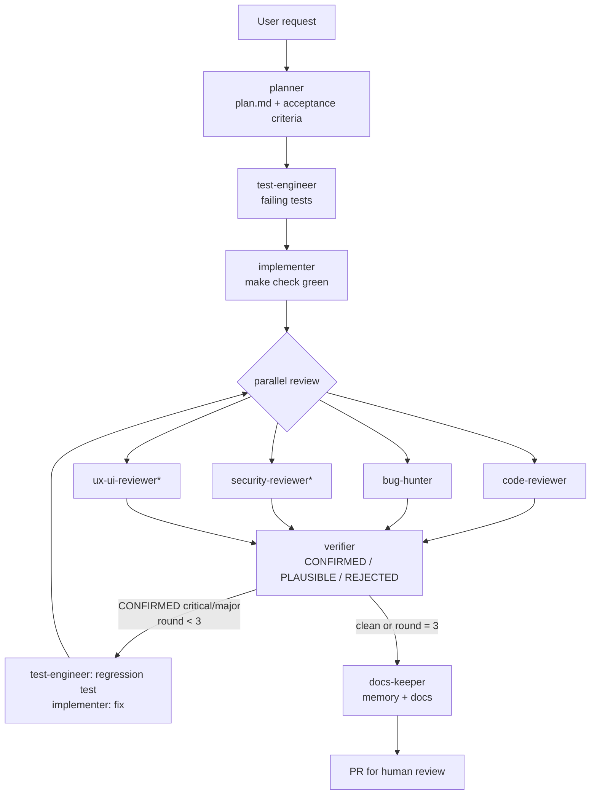

# Multi-agent workflow

How the agents in this repository divide work, hand it off, and check each other.
The design is based on published practice from Anthropic, OpenAI and GitHub; see
[`research.md`](research.md) for sources.

## Principles

1. **Separation of duties.** Planning, testing, implementing, reviewing and verifying
   are done by different agents with fresh contexts. A reviewer that did not write
   the code is not biased toward it (Claude Code best practices,
   https://code.claude.com/docs/en/best-practices).
2. **Test-first, by a different agent.** `test-engineer` writes failing tests from the
   acceptance criteria; `implementer` makes them pass and may not edit tests.
3. **Find → Verify → Rank.** Several specialist reviewers look for problems in
   parallel; an independent `verifier` rejects false positives before anyone fixes
   anything (same structure as Claude Code Review,
   https://code.claude.com/docs/en/code-review).
4. **Evaluator-optimizer loop with a budget.** Fix → re-review → re-verify, at most
   3 rounds, then escalate to a human (pattern from Anthropic, "Building effective
   agents", https://www.anthropic.com/engineering/building-effective-agents).
5. **Evidence, not claims.** Every report includes the commands run and their output.
6. **Deterministic guardrails.** Rules that must never be broken are enforced by hooks
   and CI, not only by prompts (hooks are deterministic, instructions are advisory -
   https://code.claude.com/docs/en/hooks).
7. **One feature per session, state on disk.** Progress lives in `memory/` and git so a
   fresh session can resume (https://www.anthropic.com/engineering/effective-harnesses-for-long-running-agents).

## Roles

| Agent | Writes to | Model | Purpose |
| --- | --- | --- | --- |
| `planner` | `.work/`, `docs/` | opus | Plan, acceptance criteria, test plan, risks, ADR draft |
| `test-engineer` | `tests/` | sonnet | Failing tests first, regression tests for confirmed bugs |
| `implementer` | `src/` | sonnet | Make tests pass, fix CONFIRMED findings, commit |
| `code-reviewer` | `.work/` (findings only) | sonnet | Correctness, maintainability, test quality |
| `security-reviewer` | `.work/` (findings only) | sonnet | Vulnerabilities, secrets, dependency and CI risk |
| `ux-ui-reviewer` | `.work/` (findings only) | sonnet | Real-browser flows, a11y, visual consistency, copy |
| `bug-hunter` | `.work/` (repro only) | sonnet | Adversarial testing with reproducible failures |
| `verifier` | `.work/` | opus | Confirm/reject every finding, dedupe, rank |
| `docs-keeper` | `memory/`, `docs/`, README | haiku | Progress log, decisions, lessons, feature status |

Model choices are defaults: stronger models where judgment matters (planning,
verification), cheaper ones for routine work. Change the `model:` field per agent.

## Pipeline (`/feature`)



`*` only when the diff touches security-relevant or user-facing code.

In CI, a second, independent review runs on the PR (`.github/workflows/claude-review.yml`),
and a human makes the merge decision. Agents never approve or merge.

## Artifacts in `.work/<task-slug>/`

| File | Producer | Consumer |
| --- | --- | --- |
| `plan.md` | planner | everyone |
| `findings-code.md`, `findings-security.md`, `findings-ux.md`, `findings-bugs.md` | reviewers | verifier |
| `repro/` | bug-hunter | verifier, test-engineer |
| `screens/` | ux-ui-reviewer | verifier, human |
| `verified-findings.md` | verifier | implementer, test-engineer, human |

`.work/` is git-ignored: it is a scratch handoff space. Anything worth keeping goes to
`memory/` or `docs/` via `docs-keeper`.

## Handoff report

Every subagent ends with this report (the orchestrator keeps only this, not the full
transcript):

```markdown
### Handoff: <agent> - <task-slug>
- **Status:** done | blocked | needs-decision
- **Summary:** 1-3 sentences
- **Artifacts:** paths written
- **Evidence:** commands run + relevant output (trimmed)
- **Findings:** count by severity (reviewers) or n/a
- **Open questions / next step:**
```

## Finding format

```yaml
- id: CR-1                # CR | SEC | UX | BUG | VER
  severity: critical      # critical | major | minor | nit (see REVIEW.md)
  confidence: high        # high | medium | low
  location: src/api/users.ts:42
  problem: One sentence.
  failure_scenario: concrete input -> wrong output / crash (exact command for BUG)
  suggested_fix: One or two sentences.
  verdict: CONFIRMED      # added by verifier: CONFIRMED | PLAUSIBLE | REJECTED
  verdict_reason: ...
```

## Cross-tool mapping

| Concept | Claude Code | OpenAI Codex | GitHub Copilot |
| --- | --- | --- | --- |
| Project instructions | `CLAUDE.md` (imports `AGENTS.md`) | `AGENTS.md` | `AGENTS.md`, `.github/copilot-instructions.md` |
| Subagents | `.claude/agents/*.md` (source) | `.codex/agents/*.toml` (generated) | `.github/agents/*.agent.md` (generated) |
| Skills | `.claude/skills/*/SKILL.md` (source) | `.agents/skills/` (generated) | - |
| Guardrails | `.claude/settings.json` hooks | sandbox / approval policy | repository rulesets |

Edit only the sources and run `python3 scripts/sync_agents.py`; CI fails if generated
files are stale.

## Tools

- **Browser for UX review and e2e:** `.mcp.json` registers Playwright MCP
  (https://github.com/microsoft/playwright-mcp). Playwright also ships its own
  planner/generator/healer test agents: `npx playwright init-agents --loop=<tool>`
  (check the `--loop` values for your tool in https://playwright.dev/docs/test-agents) - optional, complementary to `ux-ui-reviewer`.
- **Cost control:** multi-agent runs use many more tokens than a single chat (Anthropic
  measured ~15x for their research system,
  https://www.anthropic.com/engineering/multi-agent-research-system). Use `/feature` for
  real features, not for one-line fixes; for small fixes run the implementer directly
  and `/review` once.
