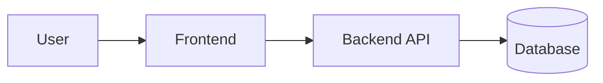

# Architecture

<!-- TODO(bootstrap): describe the real system. Keep diagrams in Mermaid so agents can edit them. -->

## Components
- TODO(bootstrap)

## Key decisions
See `docs/adr/` and `memory/decisions.md`.
