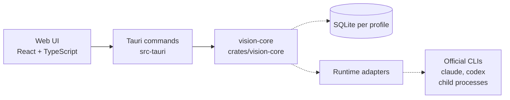

# Architecture

Full design: [`docs/PLAN.md`](PLAN.md) §2. Decisions: [ADR-0002](adr/0002-tauri-2-rust-core.md),
[ADR-0003](adr/0003-sqlite-per-profile.md), [ADR-0004](adr/0004-official-clis-subscription-sign-in.md).

Reduced diagram. Solid = exists after F-001; dashed = planned.

## Components
- **UI** (`src/`): React + TypeScript; talks to the core only through Tauri commands and events (PLAN §2.1).
- **Tauri shell** (`src-tauri/`): command registration, window config, strict CSP, per-window capabilities. Currently one command, `app_info`.
- **Core** (`crates/vision-core/`): domain logic with no Tauri dependency; later profile, project, orchestrator, policy, knowledge and event-log services (PLAN §2.1).
- **Runtime adapters** (planned, M2+): start official CLIs and normalise their streams (PLAN §5.2).
- **Storage** (planned, F-003): SQLite per profile (ADR-0003).

## Key decisions
See `docs/adr/` and `memory/decisions.md`.
